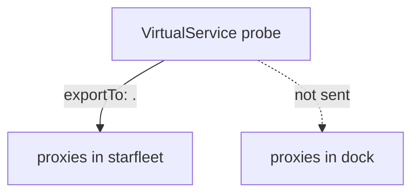

# Limit Who Sees A VirtualService Or DestinationRule With exportTo

A `VirtualService` or `DestinationRule` is an object in one namespace, but its effect does not stop at the namespace border. By default `istiod`, Istio's control plane, sends every such object to the sidecar proxies in every namespace. A team that changes the routes for its own host can therefore change what clients of other teams see. This part shows how to limit that with the `exportTo` field.

`exportTo` is a list of namespaces. It sets which namespaces receive the object. A namespace "receives" an object when the sidecar proxies of the pods in that namespace get it in their configuration. The field exists on `VirtualService`, `DestinationRule` and `ServiceEntry`. It limits visibility of configuration. It does not block requests.

## The values of exportTo

The list can hold these values:

| Value | Meaning |
| --- | --- |
| `"."` | Only the namespace the object is in |
| `"*"` | All namespaces. This is the default when the field is missing |
| `"~"` | No namespace at all, not even the object's own |
| a namespace name | That namespace, for example `dock` |

The values `"."` and a namespace name can be mixed in one list, for example `".", "dock"`. The mesh-wide default can be changed with the `defaultVirtualServiceExportTo` and `defaultDestinationRuleExportTo` fields of the mesh configuration. The playground does not change them, so the default is `"*"`.

## Prove who receives a VirtualService

The playground has a second namespace, `dock`, with sidecar injection and its own `shuttle` client pod. A client in `dock` cannot use the short name `probe`, because a short name resolves in the client's own namespace. It uses the full name `probe.starfleet.svc.cluster.local`.

The commands below need the `probe` `DestinationRule` (the playground applies it). First remove the `VirtualService` objects from the previous part, if you created them. Then send requests to `/get` from both namespaces:

<!-- astrona:playground:renew -->

```sh
kubectl delete virtualservice probe probe-hostname probe-delay -n starfleet --ignore-not-found
astrona res run count-versions.sh -- starfleet shuttle http://probe:8000/get
astrona res run count-versions.sh -- dock shuttle http://probe.starfleet.svc.cluster.local:8000/get
```

Both clients get `status 200` 10 times. Now write a `VirtualService` that answers `503` to every request for the probe. It uses a fault abort: the proxy returns the error itself and does not send the request on. It is a clear signal, because a client either has the object or it does not. Save this as `virtualservice-probe.yaml`:

```yaml
apiVersion: networking.istio.io/v1
kind: VirtualService
metadata:
  name: probe
  namespace: starfleet
spec:
  hosts:
  - probe
  exportTo:
  - "."
  http:
  - fault:
      abort:
        httpStatus: 503
        percentage:
          value: 100
    route:
    - destination:
        host: probe
        port:
          number: 8000
```

Apply it:

```sh
kubectl apply -f virtualservice-probe.yaml
```

Then check the result from both namespaces. Wait a few seconds after the apply, because `istiod` needs a moment to send the configuration:

```sh
astrona res run count-versions.sh -- starfleet shuttle http://probe:8000/get
astrona res run count-versions.sh -- dock shuttle http://probe.starfleet.svc.cluster.local:8000/get
```

The client in `starfleet` gets `status 503` 10 times. The client in `dock` still gets `status 200` 10 times. Both clients call the same Service. The difference is that only the proxy in `starfleet` received the `VirtualService`, because `exportTo` is `"."`.



The diagram shows that the object in `starfleet` reaches only the proxies of its own namespace when `exportTo` is `"."`.

The proxy configuration shows the same fact. Compare the route tables for port `8000` of the two clients:

```sh
istioctl proxy-config routes deploy/shuttle -n starfleet --name 8000
istioctl proxy-config routes deploy/shuttle -n dock --name 8000
```

In the table of the `starfleet` client, the rows for the probe host name the `VirtualService` `probe.starfleet` in the last column. In the table of the `dock` client, the same rows name no `VirtualService`.

## Export to a list of namespaces

To give the object to `dock` as well, add the namespace to the list. Save this as `virtualservice-probe.yaml` again, with the new list:

```yaml
apiVersion: networking.istio.io/v1
kind: VirtualService
metadata:
  name: probe
  namespace: starfleet
spec:
  hosts:
  - probe
  exportTo:
  - "."
  - dock
  http:
  - fault:
      abort:
        httpStatus: 503
        percentage:
          value: 100
    route:
    - destination:
        host: probe
        port:
          number: 8000
```

Apply it:

```sh
kubectl apply -f virtualservice-probe.yaml
```

Then check the result. After a few seconds both clients get `status 503`:

```sh
astrona res run count-versions.sh -- dock shuttle http://probe.starfleet.svc.cluster.local:8000/get
```

A namespace that is not on the list, for example a third namespace, still would not receive the object. This is the point of the list: you choose exactly who gets it. The value `"~"` is the extreme case. With `"~"` no proxy receives the object, so it has no effect on any request.

## A DestinationRule needs the same care

A `VirtualService` route can name a subset. The proxy builds the subset from a `DestinationRule` that it received. If the `VirtualService` reaches a namespace and the `DestinationRule` does not, the proxy there has a route to a subset that it cannot build. The request fails with `503`.

The next step shows it. Replace the `VirtualService` with one that sends `/hostname` to subset `v2` and is exported to all namespaces. Save this as `virtualservice-probe.yaml`:

```yaml
apiVersion: networking.istio.io/v1
kind: VirtualService
metadata:
  name: probe
  namespace: starfleet
spec:
  hosts:
  - probe
  exportTo:
  - "*"
  http:
  - match:
    - uri:
        prefix: /hostname
    route:
    - destination:
        host: probe
        subset: v2
        port:
          number: 8000
  - route:
    - destination:
        host: probe
        port:
          number: 8000
```

Then save this `DestinationRule` as `destinationrule-probe.yaml`. It has the same subsets as before, but it is exported to its own namespace only:

```yaml
apiVersion: networking.istio.io/v1
kind: DestinationRule
metadata:
  name: probe
  namespace: starfleet
spec:
  host: probe
  exportTo:
  - "."
  subsets:
  - name: v1
    labels:
      version: v1
  - name: v2
    labels:
      version: v2
```

Apply both:

```sh
kubectl apply -f virtualservice-probe.yaml -f destinationrule-probe.yaml
```

Then check the result from both namespaces. The `starfleet` client has both objects. The `dock` client has the `VirtualService` but not the subsets:

```sh
astrona res run count-versions.sh -- starfleet shuttle http://probe:8000/hostname
astrona res run count-versions.sh -- dock shuttle http://probe.starfleet.svc.cluster.local:8000/hostname
kubectl logs -n dock deploy/shuttle -c istio-proxy --tail=1
```

The `starfleet` client gets `probe-v2` 10 times. The `dock` client gets `status 503` 10 times. The access log line of the `dock` proxy shows the status `503` with the response flag `NC` (no cluster): the route names a subset for which the proxy has no cluster. The log line can take a few seconds to appear.

Fix it by exporting the `DestinationRule` to `dock` too. Save this as `destinationrule-probe.yaml`:

```yaml
apiVersion: networking.istio.io/v1
kind: DestinationRule
metadata:
  name: probe
  namespace: starfleet
spec:
  host: probe
  exportTo:
  - "."
  - dock
  subsets:
  - name: v1
    labels:
      version: v1
  - name: v2
    labels:
      version: v2
```

Apply it:

```sh
kubectl apply -f destinationrule-probe.yaml
```

Then check the result. After a few seconds the `dock` client gets `probe-v2` 10 times:

```sh
astrona res run count-versions.sh -- dock shuttle http://probe.starfleet.svc.cluster.local:8000/hostname
```

You now know that `exportTo` decides which namespaces receive an object, that a `VirtualService` and the `DestinationRule` it uses must reach the same clients, and that a missing `DestinationRule` shows up as `503 NC`. `exportTo` hides configuration. It does not stop a client from reaching the Service: the client in `dock` still reached `probe` every time. The open question is how to make a rule depend on who sends the request.

> [!TIP]
> When a `VirtualService` works from one namespace and has no effect from another, read the `exportTo` list of the `VirtualService` and of its `DestinationRule` first. A short list is the most common cause, and it is faster to check than the proxy configuration.

## Common pitfalls

> [!WARNING]
> - **Exporting the `VirtualService` and forgetting the `DestinationRule`.** The client gets `503 NC` for the subset. Give both objects the same `exportTo`.
> - **Reading `"."` as "the client's namespace".** It means the namespace that holds the object.
> - **Calling the host by its short name from another namespace.** A short name resolves in the client's own namespace. Use `probe.starfleet.svc.cluster.local` from `dock`.
> - **Using `exportTo` as access control.** It removes configuration from proxies. The client can still send requests to the Service. Use an `AuthorizationPolicy` to deny requests.
> - **Waiting too little after a change.** `istiod` pushes the change to the proxies a moment after you apply it. Wait a few seconds before you test.

## Your mission: Show A VirtualService To The Namespaces That Need It Lab

You can now limit who receives a `VirtualService` and a `DestinationRule`, and prove it from clients in other namespaces. The mission gives you a mesh where a `VirtualService` has no effect in a second namespace. You find out why and fix it without exposing the object to a third namespace.

Pause the playground, then start the lab and submit it:

```sh
astrona stop ats-014-playground-010-04
astrona run --git git@github.com:astrona-io/ATS014.git -c sections/section-010/module-04/labs/lab-02
astrona submit -c sections/section-010/module-04/labs/lab-02
```

When you are done, remove the lab and start the playground again:

```sh
astrona destroy ats-014-lab-010-04-02
astrona start ats-014-playground-010-04
```
