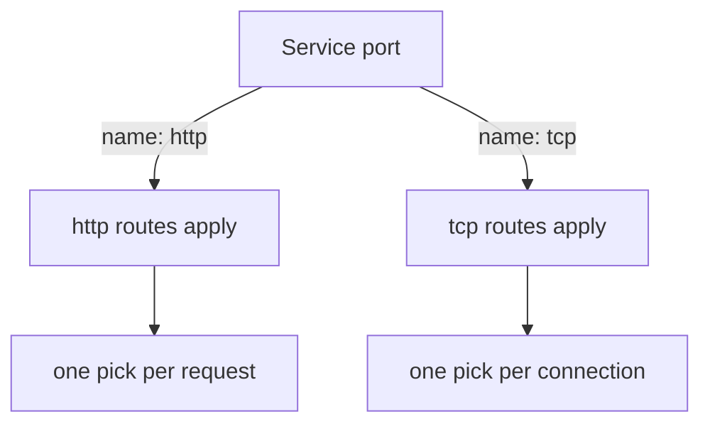

# Write A Weighted tcp Route

A weighted route for HTTP lives in the `http` section of a `VirtualService`, and the sidecar proxy applies it to every request. Some traffic cannot use that section, because the proxy does not read it as HTTP. A database connection is one example. For such traffic a `VirtualService` has a second section, `tcp`, and it also accepts weighted destinations. This part writes that route and proves it applies.

The **sidecar proxy** (Envoy) is the proxy container Istio adds to each pod; all traffic in and out of the pod passes through it. A **`VirtualService`** is the Istio object that sets where traffic to a host goes, and a **`DestinationRule`** is the Istio object that defines subsets, which are named groups of a Service's pods selected by labels.

## Which section of a VirtualService applies

Istio decides the protocol for each **Service port**, and the decision picks the section of the `VirtualService` that can apply. This is called **protocol selection**. Istio checks the port's `appProtocol` field first. If that field is not set, Istio reads the port's `name`: `http` and `http-web` mean HTTP, and `tcp` and `tcp-mysql` mean plain TCP.

For an HTTP port, the proxy reads each request, so the `http` section applies. For a TCP port, the proxy only sees connections, so the `tcp` section applies. A `tcp` section on a Service whose port is named `http` does nothing, and the last part of this module shows what that looks like.



The diagram shows how the port name leads to the section of the `VirtualService` that applies, and to the unit of each weighted pick.

## A second Service for the same pods

The `probe` pods already answer HTTP behind the Service `probe`, whose port is named `http`. You do not change that Service. Instead you create a second Service, `probe-tcp`, that selects the same pods and names its port `tcp`. The pods still speak HTTP, so `curl` and the `/hostname` path keep working. Only the proxy of the client treats the traffic as plain TCP.

<!-- astrona:playground:renew -->

Save this as `service-probe-tcp.yaml`:

```yaml
apiVersion: v1
kind: Service
metadata:
  name: probe-tcp
  namespace: starfleet
  labels:
    app: probe
spec:
  selector:
    app: probe
  ports:
  - name: tcp
    port: 8000
    targetPort: 8080
```

Apply it:

```sh
kubectl apply -f service-probe-tcp.yaml
```

Then check what the proxy of `shuttle` made of it. The route table lists only hosts with an HTTP route, so look for `probe-tcp` in it, and then look at the clusters:

```sh
istioctl proxy-config routes deploy/shuttle -n starfleet --name 8000
istioctl proxy-config clusters deploy/shuttle -n starfleet --fqdn probe-tcp.starfleet.svc.cluster.local
```

The route table lists the `probe` host and no host named `probe-tcp`, because a TCP port has no HTTP route. The cluster list shows one outbound cluster for port `8000` of `probe-tcp`, with an empty subset column. A **cluster** is Envoy's name for one destination it can send traffic to. A subset becomes its own cluster, and none exists yet.

## Define the subsets

A `tcp` route sends connections to subsets, so the `DestinationRule` comes first. It is written for the host `probe-tcp`, because subsets belong to a host. Save this as `destinationrule-probe-tcp.yaml`:

```yaml
apiVersion: networking.istio.io/v1
kind: DestinationRule
metadata:
  name: probe-tcp
  namespace: starfleet
spec:
  host: probe-tcp
  subsets:
  - name: v1
    labels:
      version: v1
  - name: v2
    labels:
      version: v2
```

Apply it, and list the clusters again:

```sh
kubectl apply -f destinationrule-probe-tcp.yaml
istioctl proxy-config clusters deploy/shuttle -n starfleet --fqdn probe-tcp.starfleet.svc.cluster.local
```

The list now has a cluster for each subset, with `v1` and `v2` in the subset column. Their names follow the pattern `outbound|8000|v1|probe-tcp.starfleet.svc.cluster.local`.

## Write the tcp route

The weighted route goes in the `tcp` section. It has the same shape as an HTTP route, with two differences: the `match` can only use fields of a connection, and there are no paths, headers or methods. Save this as `virtualservice-probe-tcp.yaml`:

```yaml
apiVersion: networking.istio.io/v1
kind: VirtualService
metadata:
  name: probe-tcp
  namespace: starfleet
spec:
  hosts:
  - probe-tcp
  tcp:
  - match:
    - port: 8000
    route:
    - destination:
        host: probe-tcp
        subset: v1
        port:
          number: 8000
      weight: 80
    - destination:
        host: probe-tcp
        subset: v2
        port:
          number: 8000
      weight: 20
```

Apply it:

```sh
kubectl apply -f virtualservice-probe-tcp.yaml
```

Four fields matter here:

- **`tcp`** is a list of routes, read top to bottom, like `http`. The first route whose `match` fits the connection wins.
- **`match.port`** is the port of the **Service** (`8000`), not the container port (`8080`). A route with no `match` applies to every connection to the host.
- **`weight`** sits on the route item, next to `destination`. Write weights that add up to 100.
- **`destination.port.number`** names the Service port. It is optional when the Service has one port, but it makes the route explicit.

## Prove the proxy holds the weights

`istiod`, the control plane, turns the route into configuration for the proxy of every client. For TCP, the route becomes part of a **listener**, which is the part of Envoy that accepts connections on an address and port. Read the listener for port `8000` as JSON, and look at the weighted clusters:

```sh
istioctl proxy-config listener deploy/shuttle -n starfleet --port 8000 -o json | grep -A12 weightedClusters
```

You should see a `weightedClusters` block that lists two clusters, `outbound|8000|v1|probe-tcp.starfleet.svc.cluster.local` and the same name with `v2`, each with its weight. If the block is missing, wait a few seconds and run the command again, because `istiod` needs a moment to push the change.

Now send 20 connections, and count which version answered:

```sh
astrona res run count-connections.sh -- 20
```

You should see most answers from `probe-v1` and a few from `probe-v2`, about 16 and 4. The exact numbers change from run to run, because the proxy makes a random pick for every connection. The next part explains why 20 samples are too few to judge the split.

You now know how to make Istio treat a port as plain TCP, how to define the subsets, how to write a `tcp` route with a `match` on the port and weighted destinations, and how to read the weighted clusters out of a live proxy. The open question is what one weighted pick actually covers: a request, or something longer.

## Common pitfalls

> [!WARNING]
> - **Naming the port wrongly.** Use a port named `tcp` (or starting with `tcp-`), or set `appProtocol: tcp`. A port named `http` ignores a `tcp` route and gives no error.
> - **Matching on the container port.** `match.port` is the Service port (`8000`). The container port (`8080`) never matches.
> - **Writing the subsets in a rule for the wrong host.** The `DestinationRule` host must be `probe-tcp`. Subsets of `probe` do not exist for `probe-tcp`.
> - **Putting `weight` inside `destination`.** It sits next to `destination`, not inside it.
> - **Using the Service `probe` in the test.** Its port is named `http`, so the `tcp` route does not apply to it. Send the test traffic to `probe-tcp`.
