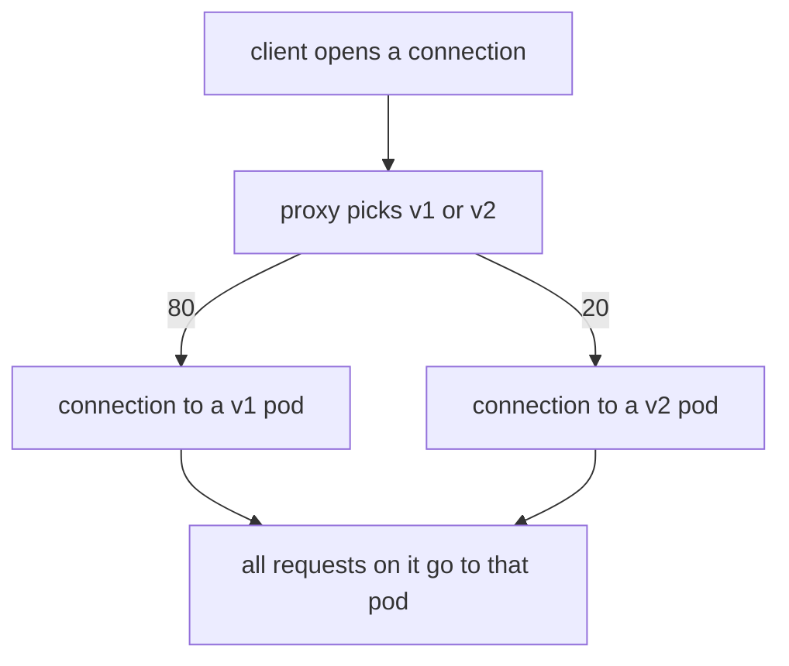

# Per-Connection Weights, Connection Reuse And Counting

A `tcp` route with weights 80 and 20 splits connections 80/20, but a count of 20 samples cannot prove it. A weighted pick for HTTP covers one request. A weighted pick for TCP covers one connection, and a connection can carry many requests. This part shows what that means for a client that keeps its connection open, and how to count a split so the result means something.

The commands below need the Service `probe-tcp`, the `DestinationRule` `probe-tcp` and the `VirtualService` `probe-tcp` applied in your playground, with weights 80 and 20.

## When the weighted pick happens

When a client opens a connection to `probe-tcp:8000`, the sidecar proxy of the client accepts it and makes one weighted pick. The proxy then opens a connection to a pod of the chosen subset and copies the bytes both ways. The pick is not repeated: every byte of that connection goes to the same pod until the connection closes. A **connection** is one TCP session between a client and a server. HTTP keep-alive lets a client send many requests over one connection.



The diagram shows that the proxy chooses once, when the connection opens, and that every later request on the same connection follows that choice.

## One connection, many requests

<!-- astrona:playground:renew -->

The helper `count-reused.sh` gives one `curl` process many URLs. `curl` reuses its connection for all of them. Send 20 requests over one connection, and repeat the command three times:

```sh
astrona res run count-reused.sh -- 20
astrona res run count-reused.sh -- 20
astrona res run count-reused.sh -- 20
```

Every run should show all 20 answers from one pod name, either `probe-v1` or `probe-v2`. Most runs show `probe-v1`, and an occasional run shows `probe-v2`. Twenty requests produced one weighted pick. Counting requests over one connection therefore does not measure the weights.

Now compare this with the HTTP Service `probe`, which has no `VirtualService`. The same helper takes the target as second argument:

```sh
astrona res run count-reused.sh -- 20 probe:8000
```

On the HTTP port, the proxy reads each request, so it picks a pod for every request, even on one connection. You should normally see both versions in the answers. The difference comes from the port name, not from the client.

## Fresh connections for every sample

To measure a TCP split you need one sample per connection. The helper `count-connections.sh` starts a new `curl` process for each sample, and a new process always opens a new connection. Count 100 connections:

```sh
astrona res run count-connections.sh -- 100
```

The result should be close to 80 answers from `probe-v1` and 20 from `probe-v2`. Run it twice more and compare. The numbers change, and both sets of numbers are normal.

## How many connections to count

Each connection is an independent random pick, so the count of `v2` answers follows a binomial distribution. For 100 connections and a 20% weight, the expected count is 20, and the standard deviation is the square root of 100 x 0.2 x 0.8, which is 4. A count between 12 and 28 is within two standard deviations, so it is normal. A count of 20 connections has a standard deviation of 1.8 around an expected 4, so it cannot tell 20% from 10% or 30%.

Use at least 100 connections, and judge the result with a range, not an exact number. This is also how the grader of the lab below judges your split.

## The access log shows each connection

The sidecar proxy of `shuttle` also writes access log lines for TCP. The line is written when the connection closes, and it has no method or path, because the proxy never read a request. Look for the cluster name that the connection used:

```sh
kubectl logs -n starfleet deploy/shuttle -c istio-proxy --tail=40 | grep probe-tcp
```

You should see one line per connection, and each line contains the upstream cluster name, `outbound|8000|v1|probe-tcp.starfleet.svc.cluster.local` or the same name with `v2`. If the lines are not there yet, wait a few seconds and run it again, because the proxy writes a line only after the connection has closed.

## Weights that do not add up to 100

Write weights that add up to 100. This module always does, and a task that says "20%" means a weight of 20 out of 100. You can check what your proxy does with another total. Patch the weights to 3 and 1, read the weights in the listener, and count 100 connections:

```sh
kubectl patch virtualservice probe-tcp -n starfleet --type json \
  -p '[{"op":"replace","path":"/spec/tcp/0/route/0/weight","value":3},{"op":"replace","path":"/spec/tcp/0/route/1/weight","value":1}]'
istioctl proxy-config listener deploy/shuttle -n starfleet --port 8000 -o json | grep -A12 weightedClusters
astrona res run count-connections.sh -- 100
```

Compare the count with the ratio 3 to 1. Whatever you see is the answer for this proxy version, and you should not rely on it in a real change. Put the weights back to 80 and 20 before you go on:

```sh
kubectl patch virtualservice probe-tcp -n starfleet --type json \
  -p '[{"op":"replace","path":"/spec/tcp/0/route/0/weight","value":80},{"op":"replace","path":"/spec/tcp/0/route/1/weight","value":20}]'
```

You now know that the proxy of the client makes one weighted pick per connection, that a reused connection stays on one pod, that a TCP split needs fresh connections to be measured, and that at least 100 of them are needed to judge an 80/20 split. The open question is how to change the weights step by step, and how to go back.

## Common pitfalls

> [!WARNING]
> - **Counting requests over one connection.** One `curl` with many URLs makes one weighted pick. Use a new process per sample.
> - **Judging a split from 10 or 20 samples.** At 20 samples, the spread is as large as the difference between 10% and 30%.
> - **Expecting an exact count.** Every run differs. Judge by a range.
> - **Testing on the HTTP Service.** The Service `probe` has an `http` port, so its requests are split per request, and the `tcp` route never applies to it.
> - **Looking for a path in the TCP access log.** The proxy never read a request, so there is none.

## Your mission: Split TCP Connections 80/20 Between Two Subsets Lab

You can now write a weighted `tcp` route and measure it with fresh connections. The mission asks you to build an 80/20 split for a TCP Service, on a cluster where the Service already exists, and the grader proves it with many fresh connections.

Pause the playground, start the lab, and send it for grading:

```sh
astrona stop ats-014-playground-020-03
astrona run --git git@github.com:astrona-io/ATS014.git -c sections/section-020/module-03/labs/lab-01
astrona submit -c sections/section-020/module-03/labs/lab-01
```

When the lab passes, remove it and start the playground again:

```sh
astrona destroy ats-014-lab-020-03-01
astrona start ats-014-playground-020-03
```
