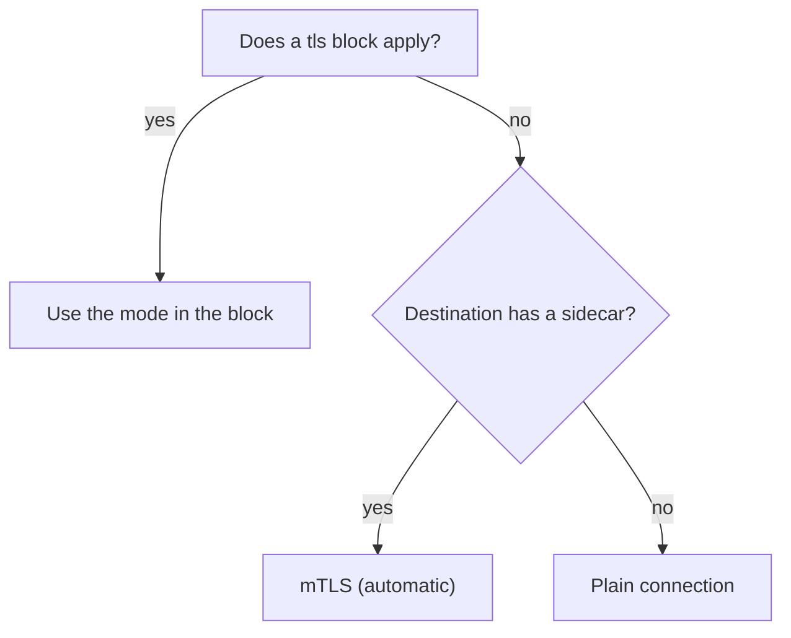

# Client TLS Modes In trafficPolicy.tls

Every request from one pod to another passes through two proxies: the sidecar proxy of the caller and the sidecar proxy of the destination. The connection between the two proxies is the one that can be encrypted. Who decides how the caller opens it? The caller's proxy decides, and the `DestinationRule` for the destination host can tell it what to do. This part shows the four settings, what the proxy does when you set none, and how to read the result from the proxy itself.

Some terms first. A **sidecar proxy** is the Envoy proxy container that Istio adds to each pod. A `DestinationRule` is the Istio object that holds policies for traffic to one host. **TLS** (Transport Layer Security) encrypts a connection and lets the client check the server's certificate. **Mutual TLS** (mTLS) adds a certificate from the client too, so each side proves who it is. In the mesh, `istiod` (Istio's control plane) gives every sidecar proxy a certificate that names its workload.

## What the proxy does with no tls block

The first example needs no new object. Istio has a feature called **automatic mTLS**: when no `tls` block applies to a destination, the client proxy checks whether the destination pod has a sidecar proxy. If it has, the client proxy opens an mTLS connection. If it has not, the client proxy opens a plain connection. The client proxy makes this choice for each endpoint, so one Service can have both kinds.

<!-- astrona:playground:renew -->

Set the address the helper scripts use, then send eight requests from the `shuttle` pod to the `probe`. The helper `status-codes.sh` counts the status codes:

```sh
HOSTNAME_URL=http://probe:8000/hostname
astrona res run status-codes.sh -- $HOSTNAME_URL
```

All eight requests return `200`. The request itself is plain HTTP, and the `shuttle` pod's proxy turns the connection to the `probe` pod into mTLS without any rule from you. Print the cluster of the `probe` in that proxy. A **cluster** is Envoy's name for the group of endpoints of one destination, together with the settings for connecting to them:

```sh
istioctl proxy-config cluster deploy/shuttle -n starfleet --fqdn probe.starfleet.svc.cluster.local -o json | grep -E 'transportSocket|tlsMode|envoy.transport_sockets'
```

The output has a `transportSocketMatches` list. Its entries have names that start with `tlsMode-`. One entry holds a TLS **transport socket** named `envoy.transport_sockets.tls`: this is the setting that makes the proxy open an encrypted connection. Another entry holds a plain socket. The proxy uses the TLS entry for endpoints that `istiod` marked as having a sidecar proxy. This list is how automatic mTLS looks inside the proxy.

## The four modes

You can replace the automatic choice with a `tls` block in the `trafficPolicy` of the `DestinationRule`. The field `mode` takes one of four values. The table says what the client proxy does in each one:

| Mode | What the client proxy does | Certificates |
| --- | --- | --- |
| `DISABLE` | Opens a plain connection, with no TLS | None |
| `SIMPLE` | Opens a TLS connection and checks the server's certificate; sends no client certificate | You give `caCertificates` (a file path) to check the server, or the proxy uses its default roots |
| `MUTUAL` | Opens a TLS connection, checks the server and sends a client certificate | You give `clientCertificate`, `privateKey` and `caCertificates` as file paths |
| `ISTIO_MUTUAL` | Opens an mTLS connection with the certificate that `istiod` gave to this proxy | Istio supplies them; you set none of the fields above |

`DISABLE` and `SIMPLE` do not give a client certificate. A destination that demands mTLS rejects both. `SIMPLE` and `MUTUAL` are for destinations outside the mesh, whose certificates you manage yourself. `ISTIO_MUTUAL` is the mode for destinations inside the mesh.



The diagram shows the choice of the client proxy. An explicit `tls` block always wins over the automatic choice.

## Set a mode and read the result

Set `ISTIO_MUTUAL` explicitly. Save this as `destinationrule-probe.yaml`:

```yaml
apiVersion: networking.istio.io/v1
kind: DestinationRule
metadata:
  name: probe
  namespace: starfleet
spec:
  host: probe
  trafficPolicy:
    tls:
      mode: ISTIO_MUTUAL
```

Apply it:

```sh
kubectl apply -f destinationrule-probe.yaml
```

Then print the TLS transport socket of the cluster again. The `-c` option of `grep` counts the matching lines:

```sh
istioctl proxy-config cluster deploy/shuttle -n starfleet --fqdn probe.starfleet.svc.cluster.local -o json | grep -c 'envoy.transport_sockets.tls'
```

The count is one or more: the cluster holds the TLS transport socket, because the mode you set says so. Now turn TLS off. Save this as `destinationrule-probe.yaml`, replacing the old file:

```yaml
apiVersion: networking.istio.io/v1
kind: DestinationRule
metadata:
  name: probe
  namespace: starfleet
spec:
  host: probe
  trafficPolicy:
    tls:
      mode: DISABLE
```

Apply it and count again:

```sh
kubectl apply -f destinationrule-probe.yaml
istioctl proxy-config cluster deploy/shuttle -n starfleet --fqdn probe.starfleet.svc.cluster.local -o json | grep -c 'envoy.transport_sockets.tls'
```

The count is now `0`: the cluster has no TLS transport socket, so the proxy opens plain connections. Run `astrona res run status-codes.sh -- $HOSTNAME_URL` again. The requests still return `200`, because nothing on the `probe` side demands mTLS yet.

## Reading it from the access log

The cluster dump shows the setting. The access log shows a request that used it. Each line of `kubectl logs deploy/shuttle -n starfleet -c istio-proxy --tail=3` ends with the upstream cluster name, for example `outbound|8000||probe.starfleet.svc.cluster.local`. In the default log format, the line in the log of the destination's proxy also holds the requested server name near the end. For a connection that used mTLS, that name starts with `outbound_`. For a plain connection, it is `-`. So the destination's log tells you which kind of connection arrived.

You now know the four modes, that no `tls` block means automatic mTLS to destinations with a sidecar, and how to read the choice from the cluster dump. The open question is what happens when the destination refuses plain connections, and the `DestinationRule` still says `DISABLE`.

## Common pitfalls

> [!WARNING]
> - **Thinking that no `tls` block means plain traffic.** With automatic mTLS, the proxy uses mTLS to destinations that have a sidecar.
> - **Using `SIMPLE` or `MUTUAL` for a destination inside the mesh.** Use `ISTIO_MUTUAL`; Istio supplies the certificates.
> - **Setting certificate fields with `ISTIO_MUTUAL`.** The mode does not use them.
> - **Reading only the YAML.** The cluster dump shows the setting the proxy really holds.
