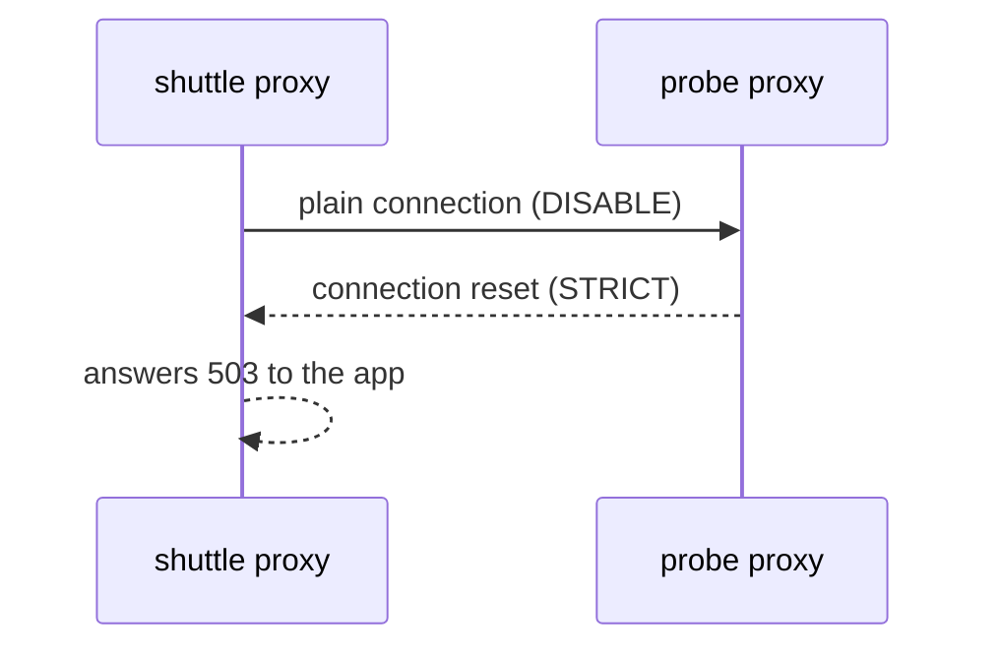

# Match A Destination That Requires mTLS

A `DestinationRule` is only half of a TLS connection. The destination has its own rule about what it accepts, and the two must agree. When they do not, the call fails, and the error message does not say "TLS". This part shows a destination that requires mTLS, how a `tls.mode: DISABLE` rule breaks calls to it, what the failure looks like, and two ways to fix it.

A **`PeerAuthentication`** is an Istio object that tells the sidecar proxy of a workload which connections it accepts. Mode `PERMISSIVE` (the default) accepts both mTLS and plain connections. Mode `STRICT` accepts only mTLS and resets every plain connection. This module uses `PeerAuthentication` only as the thing a `DestinationRule` must match; it does not teach how mTLS identity works.

## Require mTLS on the probe

<!-- astrona:playground:renew -->

Make the `probe` pods accept only mTLS. The `selector` picks the pods by label, so the rule covers the `probe` pods and nothing else in the namespace. Save this as `peerauthentication-probe.yaml`:

```yaml
apiVersion: security.istio.io/v1
kind: PeerAuthentication
metadata:
  name: probe
  namespace: starfleet
spec:
  selector:
    matchLabels:
      app: probe
  mtls:
    mode: STRICT
```

Apply it:

```sh
kubectl apply -f peerauthentication-probe.yaml
```

Remove any `DestinationRule` for the `probe`, so that only automatic mTLS is in force. Then send requests from the `shuttle` pod, which has a sidecar proxy, and one request from the `drifter` pod, which has none:

```sh
kubectl delete destinationrule probe -n starfleet --ignore-not-found
HOSTNAME_URL=http://probe:8000/hostname
astrona res run status-codes.sh -- $HOSTNAME_URL
astrona res run drifter-call.sh
```

The `shuttle` requests all return `200`. Automatic mTLS makes the `shuttle` pod's proxy open an mTLS connection, and `STRICT` accepts it. The `drifter` request does not return `200`. The `drifter` has no sidecar proxy, so it sends plain HTTP, and the `probe` pod's proxy resets the connection. The status code is usually `000`, which means curl got no HTTP response.

## A DISABLE rule breaks the mesh client

Now add a `DestinationRule` that turns client TLS off. It looks harmless, and many tutorials for destinations outside the mesh contain it. Save this as `destinationrule-probe.yaml`:

```yaml
apiVersion: networking.istio.io/v1
kind: DestinationRule
metadata:
  name: probe
  namespace: starfleet
spec:
  host: probe
  trafficPolicy:
    tls:
      mode: DISABLE
```

Apply it:

```sh
kubectl apply -f destinationrule-probe.yaml
```

Then send the requests from the `shuttle` pod again, and read the end of its access log:

```sh
astrona res run status-codes.sh -- $HOSTNAME_URL
kubectl logs deploy/shuttle -n starfleet -c istio-proxy --tail=3
```

The requests no longer return `200`. The usual status is `503`. The explicit `DISABLE` stops automatic mTLS, so the `shuttle` pod's proxy sends plain text. The `probe` pod's proxy requires mTLS, so it closes the connection. The `shuttle` pod's proxy then has no response to pass on and answers `503` itself, with a message like "upstream connect error or disconnect/reset before headers". In the log line, look at the status code, the flags column after it, and the cluster name `outbound|8000||probe.starfleet.svc.cluster.local`. The symptom is a connection reset, not a certificate error.



The diagram shows where the failure happens: between the two proxies, before the request reaches the `probe` container.

## Two ways to fix it

The first fix says explicitly what automatic mTLS would do. Save this as `destinationrule-probe.yaml`, replacing the old file:

```yaml
apiVersion: networking.istio.io/v1
kind: DestinationRule
metadata:
  name: probe
  namespace: starfleet
spec:
  host: probe
  trafficPolicy:
    tls:
      mode: ISTIO_MUTUAL
```

Apply it and send the requests again:

```sh
kubectl apply -f destinationrule-probe.yaml
astrona res run status-codes.sh -- $HOSTNAME_URL
```

All requests return `200` again. The second fix is to remove the `tls` block, or the whole `DestinationRule` if it holds nothing else, and let automatic mTLS decide. Use `ISTIO_MUTUAL` when you keep the rule for other reasons, such as subsets, and want the intent written down.

Other mismatches fail in the same way. `SIMPLE` sends no client certificate, so `STRICT` rejects it. The match is: a destination with `STRICT` needs a client that sends mTLS, and from a sidecar proxy that means `ISTIO_MUTUAL` or no `tls` block. A destination with `PERMISSIVE` works with any of them.

## A client with no sidecar proxy

The `drifter` failed before you added any `DestinationRule`, and no `DestinationRule` can fix it. The reason is who reads the rule: the sidecar proxy of the client. The `drifter` has no sidecar proxy, so nothing reads the rule, and the `drifter` sends plain text. To let the `drifter` reach the `probe`, you change the destination side (a `PeerAuthentication` with `PERMISSIVE` for that workload) or you give the `drifter` a sidecar proxy. Run `astrona res run drifter-call.sh` once more to see that the `drifter` still gets no `200`.

You now know that the client's `tls` mode and the destination's `PeerAuthentication` must agree, that `DISABLE` against `STRICT` shows up as a reset connection and a `503`, and that the fix is `ISTIO_MUTUAL` or no `tls` block. The open question is what happens when one subset or one port needs a different setting from the rest.

## Common pitfalls

> [!WARNING]
> - **Copying `tls.mode: DISABLE` from an example for an outside host.** For a destination in the mesh with `STRICT`, it breaks every call.
> - **Looking for a certificate error.** The symptom is a reset connection and `503`, not a TLS message.
> - **Trying to fix the `drifter` with a `DestinationRule`.** A client with no sidecar proxy never reads one.
> - **Weakening `STRICT` to make a test pass.** Fix the client setting so it matches.
