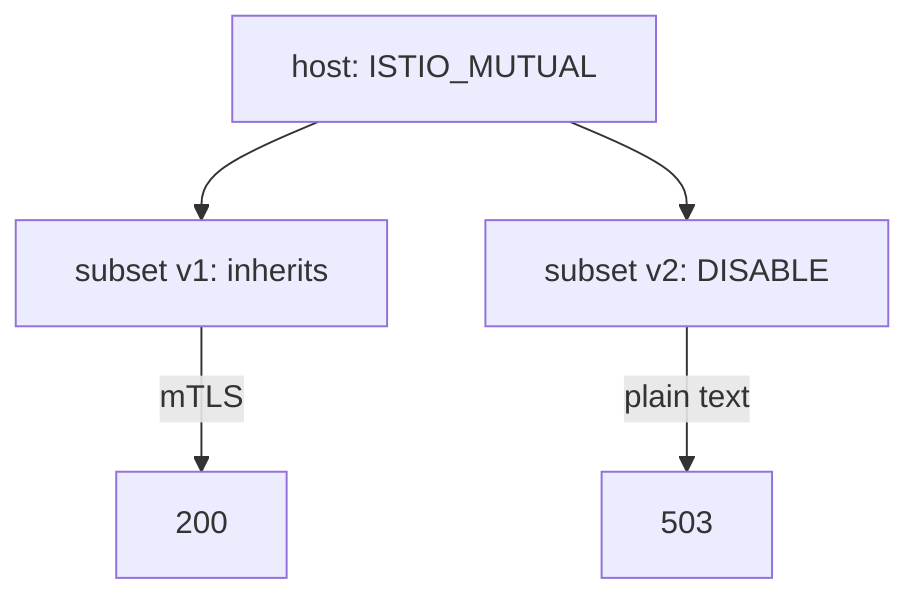

# Override TLS Per Subset And Per Port

One `DestinationRule` often serves a host with several versions and several ports, and they do not always need the same TLS setting. A subset can need its own `tls` block, and a port can need one too. This part shows how to set TLS for one subset and for one port, what a subset keeps from the host and what it replaces, and how a silent replacement can drop a load balancer you set at host level.

A `DestinationRule` is the Istio object that holds policies for traffic to one host. A **subset** is a named group of the host's pods, chosen by pod labels inside the `DestinationRule`. A `VirtualService` is the Istio object that holds routing rules; it decides which subset a request goes to. The **sidecar proxy** (the Envoy proxy that Istio adds to each pod) of the sending pod applies all of these.

## Set up the destination and the subsets

<!-- astrona:playground:renew -->

The commands below need three objects: the `probe` pods accept only mTLS, a `VirtualService` sends requests with the header `x-canary: true` to subset `v2` and all other requests to subset `v1`, and the `DestinationRule` defines the subsets. Save this as `peerauthentication-probe.yaml`:

```yaml
apiVersion: security.istio.io/v1
kind: PeerAuthentication
metadata:
  name: probe
  namespace: starfleet
spec:
  selector:
    matchLabels:
      app: probe
  mtls:
    mode: STRICT
```

Apply it:

```sh
kubectl apply -f peerauthentication-probe.yaml
```

Save this as `virtualservice-probe.yaml`:

```yaml
apiVersion: networking.istio.io/v1
kind: VirtualService
metadata:
  name: probe
  namespace: starfleet
spec:
  hosts:
  - probe
  http:
  - match:
    - headers:
        x-canary:
          exact: "true"
    route:
    - destination:
        host: probe
        subset: v2
  - route:
    - destination:
        host: probe
        subset: v1
```

Apply it:

```sh
kubectl apply -f virtualservice-probe.yaml
```

## A tls block for one subset

A subset has its own `trafficPolicy`, next to its `name` and `labels`. If it holds a `tls` block, the proxy uses that block for the subset's cluster and the host's `tls` block for the other subsets. Set `ISTIO_MUTUAL` at host level and `DISABLE` for subset `v2` only. Save this as `destinationrule-probe.yaml`:

```yaml
apiVersion: networking.istio.io/v1
kind: DestinationRule
metadata:
  name: probe
  namespace: starfleet
spec:
  host: probe
  trafficPolicy:
    tls:
      mode: ISTIO_MUTUAL
  subsets:
  - name: v1
    labels:
      version: v1
  - name: v2
    labels:
      version: v2
    trafficPolicy:
      tls:
        mode: DISABLE
```

Apply it:

```sh
kubectl apply -f destinationrule-probe.yaml
```

Then send eight requests without a header and eight with the header, and count the status codes. The first helper command sets the address:

```sh
HOSTNAME_URL=http://probe:8000/hostname
astrona res run status-codes.sh -- $HOSTNAME_URL
astrona res run status-codes.sh -- -H "x-canary: true" $HOSTNAME_URL
```

The requests without the header go to subset `v1`, which uses the host's `ISTIO_MUTUAL`, so they return `200`. The requests with the header go to subset `v2`, which sends plain text to a `STRICT` pod, so they fail with the connection reset and `503`. One subset broke and the other did not, because the subset's `tls` block replaced the host's for that subset only.



The diagram shows one host-level setting, one subset that inherits it and one subset that replaces it.

## What a subset keeps and what it replaces

A `trafficPolicy` holds these top-level fields: `loadBalancer`, `connectionPool`, `outlierDetection`, `tls` and `portLevelSettings`. Istio combines the host's policy and a subset's policy one top-level field at a time:

- A field the subset does **not** set is inherited from the host.
- A field the subset **does** set replaces the host's whole field. Nothing inside it is merged.

The second rule creates a silent problem. A subset that sets only `loadBalancer` still inherits the host's `tls`. But a subset that sets `loadBalancer` loses everything the host's `loadBalancer` said, for example a `consistentHash`. Istio reports no error. Prove it with a host that has both a `tls` block and a sticky load balancer. Save this as `destinationrule-probe.yaml`, replacing the old file:

```yaml
apiVersion: networking.istio.io/v1
kind: DestinationRule
metadata:
  name: probe
  namespace: starfleet
spec:
  host: probe
  trafficPolicy:
    tls:
      mode: ISTIO_MUTUAL
    loadBalancer:
      consistentHash:
        httpHeaderName: x-user
  subsets:
  - name: v1
    labels:
      version: v1
  - name: v2
    labels:
      version: v2
    trafficPolicy:
      loadBalancer:
        simple: RANDOM
```

Apply it:

```sh
kubectl apply -f destinationrule-probe.yaml
```

Then print the name, the load balancer policy and the TLS transport socket of each cluster of the `probe`:

```sh
istioctl proxy-config cluster deploy/shuttle -n starfleet --fqdn probe.starfleet.svc.cluster.local -o json | grep -E '"name": "outbound|"lbPolicy"|envoy.transport_sockets.tls'
```

The `v1` cluster shows `"lbPolicy": "RING_HASH"`, Envoy's name for consistent hashing, because it inherits the host's `loadBalancer`. The `v2` cluster shows `"lbPolicy": "RANDOM"`: the subset's `loadBalancer` replaced the host's, so `v2` is no longer sticky on `x-user`. Both clusters still show the TLS transport socket, because the subset did not set `tls`.

> [!TIP]
> After you add a `trafficPolicy` to a subset, read the cluster dump for every subset. A field you set in the subset replaces the host's field, and the proxy shows the result in `lbPolicy` and the transport socket.

## A tls block for one port

The field `portLevelSettings` sets a policy for one port of the host. It takes a list. Each entry names a port with `port.number` and carries its own fields, such as `tls`. The number is the **Service** port, the port that clients call. The `probe` Service listens on port `8000` and sends traffic to container port `8080`, so a port-level policy for the `probe` names `8000`.

A port-level field is more specific than the same field at host level, so it replaces the host's field for that port. To see it, break the host level on purpose, and repair it for port `8000` only. Save this as `destinationrule-probe.yaml`, replacing the old file:

```yaml
apiVersion: networking.istio.io/v1
kind: DestinationRule
metadata:
  name: probe
  namespace: starfleet
spec:
  host: probe
  trafficPolicy:
    tls:
      mode: DISABLE
    portLevelSettings:
    - port:
        number: 8000
      tls:
        mode: ISTIO_MUTUAL
  subsets:
  - name: v1
    labels:
      version: v1
  - name: v2
    labels:
      version: v2
```

Apply it and send requests:

```sh
kubectl apply -f destinationrule-probe.yaml
astrona res run status-codes.sh -- $HOSTNAME_URL
```

All requests return `200`, although the host-level mode is `DISABLE`. The port-level `ISTIO_MUTUAL` for port `8000` won. Remember the precedence you proved in this part: a subset's field beats the host's field, and a port's field beats the host's field. For any other combination, read the cluster dump, which shows the setting the proxy really holds.

You now know how to set `tls` for one subset and one port, that a subset inherits the fields it leaves out and replaces the fields it sets as a whole, and that a replaced `loadBalancer` raises no error. Two labs follow to practise both skills.

## Common pitfalls

> [!WARNING]
> - **Thinking a subset's `tls` block affects other subsets.** It replaces the host's `tls` for that subset only.
> - **Expecting a subset `loadBalancer` to merge with the host's.** It replaces the host's whole `loadBalancer`, so a `consistentHash` is lost without an error.
> - **Naming the container port in `portLevelSettings`.** It takes the Service port, `8000` for the `probe`, not `8080`.
> - **Testing a subset without a route to it.** Nothing uses a subset until a `VirtualService` sends requests to it.
> - **Checking only the YAML.** The cluster dump shows what each subset and port really got.

## Your mission: Build A DestinationRule For A STRICT Destination Lab

You can now write a `DestinationRule` for a destination that accepts only mTLS: define the subsets, set `ISTIO_MUTUAL`, and give one subset its own load balancer. The mission asks you to do this for a `probe` that already has a `PeerAuthentication` and a `VirtualService`, and to prove it with real requests and the proxy configuration. This lab uses its own cluster and the same `probe`, `shuttle` and `drifter` workloads.

Pause the playground first:

```sh
astrona stop ats-014-playground-030-02
```

Start the lab, work on it, and send it for grading:

```sh
astrona run --git git@github.com:astrona-io/ATS014.git -c sections/section-030/module-02/labs/lab-01
astrona submit -c sections/section-030/module-02/labs/lab-01
```

When you have finished, remove the lab and start the playground again:

```sh
astrona destroy ats-014-lab-030-02-01
astrona start ats-014-playground-030-02
```

## Your mission: Fix A DISABLE Rule And A Subset Override Lab

You can now find a `tls.mode: DISABLE` rule that breaks calls to a `STRICT` destination, and a subset override that silently replaces a host-level load balancer. The mission gives you a `DestinationRule` with both mistakes and asks you to fix them, and to prove the fix with live requests and the proxy configuration.

Pause the playground first:

```sh
astrona stop ats-014-playground-030-02
```

Start the lab, work on it, and send it for grading:

```sh
astrona run --git git@github.com:astrona-io/ATS014.git -c sections/section-030/module-02/labs/lab-02
astrona submit -c sections/section-030/module-02/labs/lab-02
```

When you have finished, remove the lab and start the playground again:

```sh
astrona destroy ats-014-lab-030-02-02
astrona start ats-014-playground-030-02
```
