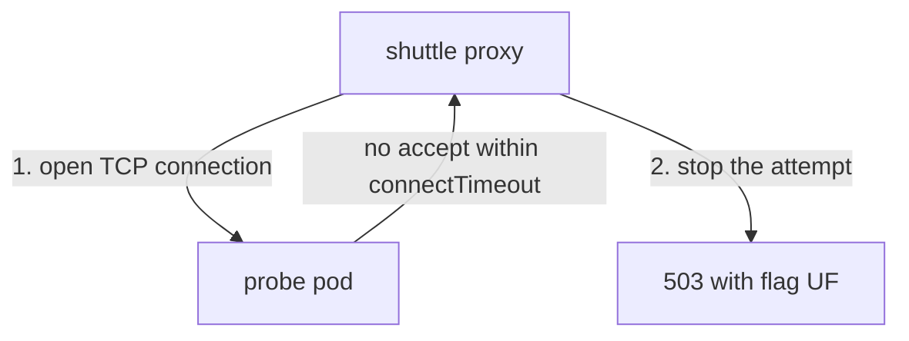

# Limit How Long A Connection Attempt Waits

Before a sidecar proxy can send a request to an upstream pod, it needs a TCP connection to that pod. The proxy opens the connection, and the upstream must accept it. Normally this takes a few milliseconds. When the upstream pod is overloaded, unreachable or blocked by a network rule, the connection attempt can hang instead.

This part shows how long the proxy waits for that connection, which field changes the wait, and what happens to the request when the wait ends. It also separates this setting from the route `timeout` in a `VirtualService`, because the two are easy to confuse.

## The connect timeout

The **connect timeout** is the longest time the proxy waits for a new TCP connection to an upstream endpoint to be established. If the upstream has not accepted the connection by then, the proxy stops the attempt. It is a field of the `DestinationRule`: `trafficPolicy.connectionPool.tcp.connectTimeout`. The value is a duration such as `2s` or `500ms`, and it must be at least `1ms`.

If you do not set it, the proxy uses the mesh default, which is 10 seconds. That is a long time for a caller to wait on a pod that does not answer. Setting a shorter value makes the proxy give up sooner and report the failure to the client, which then can retry or fail fast.

<!-- astrona:playground:renew -->

Start by reading the value the proxy of `shuttle` holds today. The command asks `istioctl` for the cluster of the `probe` host in JSON and keeps the line with the connect timeout:

```sh
istioctl proxy-config cluster deploy/shuttle -n starfleet \
  --fqdn probe.starfleet.svc.cluster.local --port 8000 -o json \
  | grep connectTimeout
```

A **cluster** here is Envoy's name for one upstream service and its endpoints. The line shows `connectTimeout` with the default of `10s`, because no `DestinationRule` exists yet.

Now set a shorter value. Save this as `destinationrule-probe-connect-timeout.yaml`:

```yaml
apiVersion: networking.istio.io/v1
kind: DestinationRule
metadata:
  name: probe
  namespace: starfleet
spec:
  host: probe
  trafficPolicy:
    connectionPool:
      tcp:
        connectTimeout: 2s
```

Apply it:

```sh
kubectl apply -f destinationrule-probe-connect-timeout.yaml
```

Then check the result. `istiod` sends the new cluster to the proxy within a few seconds, so run the same command again:

```sh
istioctl proxy-config cluster deploy/shuttle -n starfleet \
  --fqdn probe.starfleet.svc.cluster.local --port 8000 -o json \
  | grep connectTimeout
```

The line now shows `2s`. The proxy of `shuttle` holds the new value, and it applies to every new connection from `shuttle` to the `probe` Service. Requests still work, because the probe accepts connections at once:

```sh
kubectl exec -n starfleet deploy/shuttle -- curl -s -o /dev/null -w "%{http_code}\n" http://probe:8000/hostname
```

The status code is `200`. The connect timeout only matters on the day the connection does not open.

## What happens to the request

When the connect timeout expires, the proxy of the caller has not sent the request yet, because it has no connection to send it on. The proxy answers the client with a `503` status code. In the access log of the proxy the response flag is `UF`, which means upstream connection failure. The client sees a `503`, not a `504`.

Connection failures are one of the conditions a retry policy can act on. If the route has retries with `connect-failure` in `retryOn`, the proxy tries again, on the same endpoint or another one, and each new attempt can wait up to the connect timeout. This is why a connect timeout of 10 seconds is expensive with retries: two retries can keep the client waiting for 30 seconds.



The diagram shows that the proxy fails the request itself when the connection attempt runs out of time. Nothing reached the application in the probe pod.

## How this differs from the route timeout

The route `timeout` of a `VirtualService` is a different setting. It measures the whole request: from the moment the proxy starts sending it until the full response has arrived. It covers waiting for a connection, the work of the upstream and the transfer of the response. When it expires, the proxy answers `504` with the response flag `UT`.

| | Connect timeout | Route timeout |
| --- | --- | --- |
| Object and field | `DestinationRule`, `connectionPool.tcp.connectTimeout` | `VirtualService`, `http[].timeout` |
| What it measures | Only opening the TCP connection | The whole request and response |
| Status code and flag | `503`, `UF` | `504`, `UT` |
| Default | 10 seconds | No limit set by the route (the default is a disabled timeout) |

To see the route timeout work, save this as `virtualservice-probe-timeout.yaml`:

```yaml
apiVersion: networking.istio.io/v1
kind: VirtualService
metadata:
  name: probe
  namespace: starfleet
spec:
  hosts:
  - probe
  http:
  - route:
    - destination:
        host: probe
    timeout: 1s
```

Apply it:

```sh
kubectl apply -f virtualservice-probe-timeout.yaml
```

Then send a request that the probe answers after three seconds. The connection opens at once, so the connect timeout does not matter here:

```sh
kubectl exec -n starfleet deploy/shuttle -- curl -s -o /dev/null -w "%{http_code} %{time_total}\n" http://probe:8000/delay/3
```

The status code is `504`, and the time is close to one second. The proxy gave up on the response after the route timeout, although the connection was healthy. The connect timeout could not have caused this.

Remove the `VirtualService` so that only the `DestinationRule` remains:

```sh
kubectl delete virtualservice probe -n starfleet
```

You now know that the connect timeout limits only the opening of a connection, that its failure is a `503` with the flag `UF`, and that the route timeout limits the whole request and fails with `504` and `UT`. Both are set by the caller. The open question is what happens to a connection that opened fine and then sits unused, or lives too long, which is the subject of the next settings in the same `connectionPool` block.

## Common pitfalls

> [!WARNING]
> - **Using the route timeout to limit connection attempts.** A `VirtualService` `timeout` fires after the whole request, with `504`. It does not change how long the proxy waits for a connection.
> - **Expecting `504` from a connect timeout.** The client sees `503` with the response flag `UF`.
> - **Setting a very low `connectTimeout`.** A value such as `1ms` makes healthy but slightly slow upstreams fail. Pick a value above the normal connection time.
> - **Forgetting that retries multiply the wait.** Each retry can wait for a full connect timeout.
