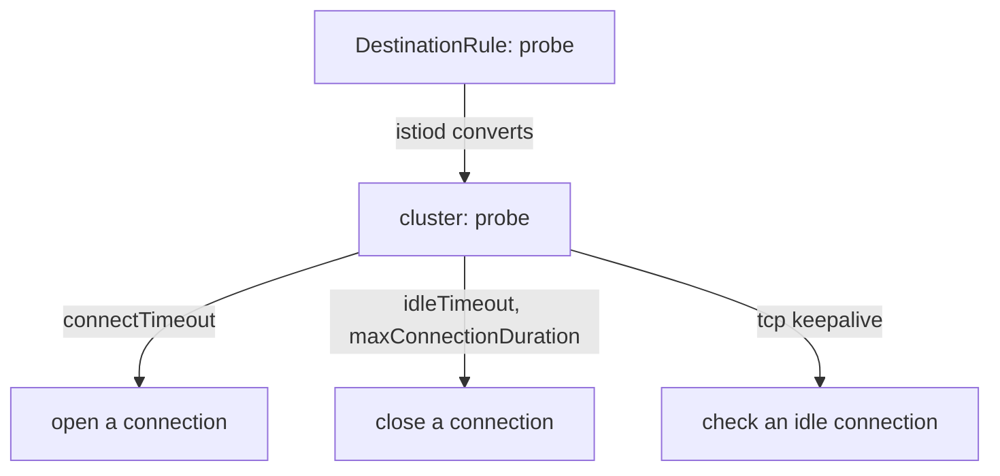

# Idle, Keepalive And Maximum Connection Age

After the proxy opens a connection, it keeps it for later requests. Reusing connections is faster than opening a new one for each request. A connection that stays open has its own risks: nobody uses it, a firewall or load balancer in the network silently drops it, or it lives so long that all its requests keep going to one endpoint.

This part shows three settings that control the life of an open connection: an idle timeout, a maximum connection duration and TCP keepalive. All three live in the `connectionPool` block of the `DestinationRule`, and each one shows up in the cluster configuration of the proxy.

## Three settings, three jobs

An **idle** connection is one with no active request. The **idle timeout**, `connectionPool.http.idleTimeout`, is the period without any active request after which the proxy closes the connection. If it is not set, the default is one hour. For an HTTP/2 connection the proxy drains the connection before it closes it. Use a shorter idle timeout when something in the network drops idle connections earlier than one hour, so the proxy closes the connection first and does not send the next request into a dead connection.

The **maximum connection duration**, `connectionPool.tcp.maxConnectionDuration`, is the longest time a connection may live, counted from the moment it was established, whether it is idle or busy. When the limit is reached, the proxy closes the connection, and the next request opens a new one. Without it there is no limit. A limit is useful when connections live very long: a new connection is balanced again across the endpoints that exist now, for example after the upstream scaled up. The value must be at least `1ms`.

**TCP keepalive**, `connectionPool.tcp.tcpKeepalive`, makes the operating system of the proxy send small probe packets on an idle connection to check that the other end still answers. It has three fields:

- `time` is how long a connection must be idle before the first probe is sent.
- `interval` is the time between two probes.
- `probes` is how many probes may go unanswered before the connection is declared dead and closed.

If you set none of the three, the operating system defaults apply. On Linux these are 7200 seconds for the time, 75 seconds for the interval and 9 probes.

The two timeouts and keepalive are different tools. The idle timeout and the maximum duration are decisions of the proxy, based on a clock. Keepalive is a question to the other end: it detects a connection that looks open but whose remote side has gone away.

<!-- astrona:playground:renew -->

## Set all of them on the probe

Save this as `destinationrule-probe-connection-settings.yaml`. It sets the connect timeout and adds the three new settings:

```yaml
apiVersion: networking.istio.io/v1
kind: DestinationRule
metadata:
  name: probe
  namespace: starfleet
spec:
  host: probe
  trafficPolicy:
    connectionPool:
      tcp:
        connectTimeout: 2s
        maxConnectionDuration: 10m
        tcpKeepalive:
          time: 60s
          interval: 10s
          probes: 4
      http:
        idleTimeout: 90s
```

Apply it:

```sh
kubectl apply -f destinationrule-probe-connection-settings.yaml
```

If a `DestinationRule` named `probe` already exists, the file replaces it, because it has the same name. Note where each field sits: `connectTimeout`, `maxConnectionDuration` and `tcpKeepalive` are under `tcp`, and `idleTimeout` is under `http`. A field under the wrong block is rejected when you apply it.

## Read them in the cluster JSON

`istiod` turns the `DestinationRule` into a cluster, which is Envoy's name for one upstream service and its endpoints, and sends it to the proxy. Read the cluster of `shuttle` back and keep only the lines for these settings:

```sh
istioctl proxy-config cluster deploy/shuttle -n starfleet \
  --fqdn probe.starfleet.svc.cluster.local --port 8000 -o json \
  | grep -E '"connectTimeout"|"idleTimeout"|"maxConnectionDuration"|"keepalive'
```

The playground has a helper that runs the same command: `astrona res run show-connection-settings.sh`. The lines show the settings under the names Envoy uses:

- `connectTimeout` has the value `2s`.
- `idleTimeout` and `maxConnectionDuration` appear inside the cluster's HTTP protocol options. The idle timeout is `90s` and the maximum duration is `600s`, the same as `10m`.
- `keepaliveProbes`, `keepaliveTime` and `keepaliveInterval` appear under the upstream connection options. The proxy writes the two durations as whole seconds: `60` and `10`. The number of probes is `4`.

If a line is missing, the proxy has not received the new cluster yet, or the field is under the wrong block. Run the command again after a few seconds.



The diagram shows that `istiod` builds one cluster from the `DestinationRule`, and that the proxy uses the settings at three moments of a connection's life: opening, closing and checking.

A last check shows that traffic still works with all the settings in place:

```sh
astrona res run count-zones.sh -- 10
```

All ten requests are answered, spread over the probe pods, because the settings change how connections behave and not where requests go.

These settings apply to connections that the proxy of the client opens to the upstream. They do not change the connections that clients open to the proxy, and they are enforced per client proxy, not across the mesh. You now know what each of the three settings does, which block holds each of them, and how to prove them from the proxy. The open question is which endpoint the proxy picks for each request, and whether it can prefer the one next to the caller.

## Common pitfalls

> [!WARNING]
> - **Putting `idleTimeout` under `tcp`.** It belongs under `http`. The `tcp` block has `maxConnectionDuration`, `connectTimeout` and `tcpKeepalive`.
> - **Expecting `maxConnectionDuration` to be an idle limit.** It counts from the moment the connection was established, even when requests are still running on it.
> - **Setting a keepalive `time` longer than the network's idle limit.** The probes then start after the network has already dropped the connection.
> - **Reading the value in the YAML and not in the proxy.** Only the cluster JSON shows what the proxy really uses. The proxy shows durations as `s` strings or whole seconds, not as you wrote them (`10m` becomes `600s`).

## Your mission: Set Connection Timeout And Keepalive On A Host Lab

You can now set the connect timeout, the idle timeout, the maximum connection duration and TCP keepalive on a `DestinationRule`, and prove them from the proxy. The mission asks you to configure these settings for a host in a fresh cluster and prove them with the cluster JSON and a live request.

Pause the playground, then start the lab and submit it:

```sh
astrona stop ats-014-playground-040-05
astrona run --git git@github.com:astrona-io/ATS014.git -c sections/section-040/module-05/labs/lab-01
astrona submit -c sections/section-040/module-05/labs/lab-01
```

When you are done, remove the lab and start the playground again:

```sh
astrona destroy ats-014-lab-040-05-01
astrona start ats-014-playground-040-05
```
