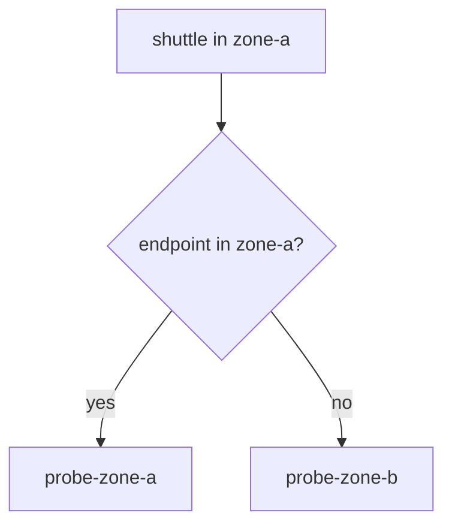

# Prefer Nearby Endpoints With trafficDistribution

A Kubernetes `Service` has several pods behind it, and the sidecar proxy of the caller picks one for each request. By default it spreads requests over all of them, whatever zone they run in. In a cluster with several zones, a request that crosses zones is slower than one inside a zone, and cloud providers often charge for it.

This part shows the simplest way to ask for nearby endpoints: one field on the Kubernetes `Service`. It also shows what the field cannot do, so you do not rely on it for more than it gives.

## Locality in one paragraph

An endpoint's **locality** is the region, zone and subzone it runs in. Istio reads it from the labels of the node that runs the pod: `topology.kubernetes.io/region` and `topology.kubernetes.io/zone`. A `kind` cluster has no zones, so in this playground each pod sets its locality with the `istio-locality` label instead, in the format `region.zone` with a dot. The `shuttle` pod runs in `local/zone-a`, as the node's labels say. `probe-zone-a` is in the same zone and `probe-zone-b` is in `local/zone-b`.

## Two places to ask for it

There are two ways to ask the mesh to prefer nearby endpoints.

The first is the Istio way. The `DestinationRule` has `trafficPolicy.loadBalancer.localityLbSetting`, with fields such as `enabled`, `distribute` and `failover`. It is configured per host, it can set exact weights between zones, and it acts only when the same `DestinationRule` has `outlierDetection`.

The second is the Kubernetes way. The `Service` has the field `spec.trafficDistribution`. The value `PreferClose` tells every client of the Service to prefer endpoints that are close to the client: the same zone first, and when there is none, further away. Istio 1.30 reads this field and applies it in the sidecar proxies. It is part of the Service, so any mesh component that reads Services sees it, and you do not need a `DestinationRule` to set it. This part teaches `PreferClose`, the value you need for the exam topic of nearby endpoints.

<!-- astrona:playground:renew -->

## Measure first

Start from the playground as it is. Check that the `Service` has no `trafficDistribution`, then send 20 requests from `shuttle` with the helper that counts which pod answered:

```sh
kubectl get service probe -n starfleet -o jsonpath='{.spec.trafficDistribution}{"\n"}'
astrona res run count-zones.sh -- 20
```

The first command prints an empty line, because the field is not set. The second command shows requests answered by both `probe-zone-a` and `probe-zone-b`, in a mix that changes from run to run. The proxy spreads requests over every endpoint.

## Set PreferClose on the Service

Save this as `service-probe-prefer-close.yaml`. It is the same `Service` as before with one new field:

```yaml
apiVersion: v1
kind: Service
metadata:
  name: probe
  namespace: starfleet
  labels:
    app: probe
spec:
  selector:
    app: probe
  trafficDistribution: PreferClose
  ports:
  - name: http
    port: 8000
    targetPort: 8080
```

Apply it:

```sh
kubectl apply -f service-probe-prefer-close.yaml
```

Then send 20 requests again. `istiod` needs a few seconds to push the change to the proxy of `shuttle`:

```sh
astrona res run count-zones.sh -- 20
```

All 20 requests are now answered by `probe-zone-a`, the pod in the zone of `shuttle`. `probe-zone-b` is healthy and part of the Service, but it only receives requests when the nearer endpoints are not available.



The diagram shows the choice the proxy of `shuttle` makes for each request: the endpoint in its own zone first, and an endpoint further away only when the own zone has none.

You can read the same decision in the endpoint list of the proxy. Look at the `priority` of each endpoint:

```sh
istioctl proxy-config endpoints deploy/shuttle -n starfleet \
  --cluster "outbound|8000||probe.starfleet.svc.cluster.local" -o json \
  | grep -E '"zone"|"priority"'
```

An endpoint with priority `0` is the preferred group, and endpoints with a higher number are used only when the group before them has no healthy endpoint left. Find the `zone-a` and `zone-b` lines and check which one has the higher priority number. The full output also has a line with `"priority": "HIGH"`, which belongs to connection limits and not to locality.

## What it cannot do

`PreferClose` is a preference, and a preference is not a guarantee.

- **It has no weights.** You cannot say that 80% should stay near and 20% should go elsewhere. That needs `distribute` in a `DestinationRule`.
- **It does not choose the fallback.** When the near endpoints are gone, the proxy uses the next nearest group. You cannot name a region.
- **It does not detect failing endpoints.** An endpoint counts as available while it is in the endpoint list. A pod that stays ready but answers `503` to every request is still the preferred one. The proxy only stops using it when outlier detection ejects it.
- **It can overload one zone.** If most clients are in one zone, most requests go to the endpoints in that zone.
- **It does not change the Service's other behaviour.** It does not create zones, and an endpoint without a locality is not near any client.

For this reason a service that must fail over still needs a `DestinationRule` with `outlierDetection`. Outlier detection is the proxy feature that ejects an endpoint after it returns a number of errors in a row. Save this as `destinationrule-probe-outlier-detection.yaml`:

```yaml
apiVersion: networking.istio.io/v1
kind: DestinationRule
metadata:
  name: probe
  namespace: starfleet
spec:
  host: probe
  trafficPolicy:
    outlierDetection:
      consecutive5xxErrors: 2
      interval: 5s
      baseEjectionTime: 30s
      maxEjectionPercent: 100
```

Apply it:

```sh
kubectl apply -f destinationrule-probe-outlier-detection.yaml
```

The `Service` now says where requests should go, and the `DestinationRule` says when an endpoint is too broken to receive them. The two do different jobs. `maxEjectionPercent: 100` matters: the default of 10 percent cannot eject one endpoint out of two.

Do not set a `localityLbSetting` on the same host while you use `PreferClose`. You would have two places that control the same preference, and you would have to reason about both when requests go to an unexpected zone.

Put the playground back to its starting state:

```sh
kubectl delete destinationrule probe -n starfleet
kubectl patch service probe -n starfleet --type json -p '[{"op":"remove","path":"/spec/trafficDistribution"}]'
```

You now know that `spec.trafficDistribution: PreferClose` on a Service keeps requests in the caller's zone, that you can prove it by counting which pods answer, and that it cannot detect a failing endpoint on its own. The open question for a real cluster is how much load one zone can take, which no field on the Service decides for you.

## Common pitfalls

> [!WARNING]
> - **Expecting failover from `PreferClose` alone.** Without outlier detection, a failing endpoint in the near zone keeps receiving requests.
> - **Expecting a hard guarantee.** `PreferClose` is a preference. When nothing near is available, requests go further away.
> - **Putting the field on the wrong object.** `trafficDistribution` is a field of the Kubernetes `Service` under `spec`. A `DestinationRule` has no such field.
> - **Pods without a locality.** On a cluster without zone labels, and without `istio-locality` on the pods, no endpoint is near any other, and the preference changes nothing.
> - **Reading only the first run.** `istiod` needs a few seconds to push the change. Wait before you count.

## Your mission: Keep Requests In The Client's Zone With trafficDistribution Lab

You can now ask a `Service` to prefer endpoints in the caller's zone and prove it by counting which pods answer. The mission asks you to do this for a `Service` in a fresh cluster, and to keep outlier detection in place for failover.

Pause the playground, then start the lab and submit it:

```sh
astrona stop ats-014-playground-040-05
astrona run --git git@github.com:astrona-io/ATS014.git -c sections/section-040/module-05/labs/lab-02
astrona submit -c sections/section-040/module-05/labs/lab-02
```

When you are done, remove the lab and start the playground again:

```sh
astrona destroy ats-014-lab-040-05-02
astrona start ats-014-playground-040-05
```
