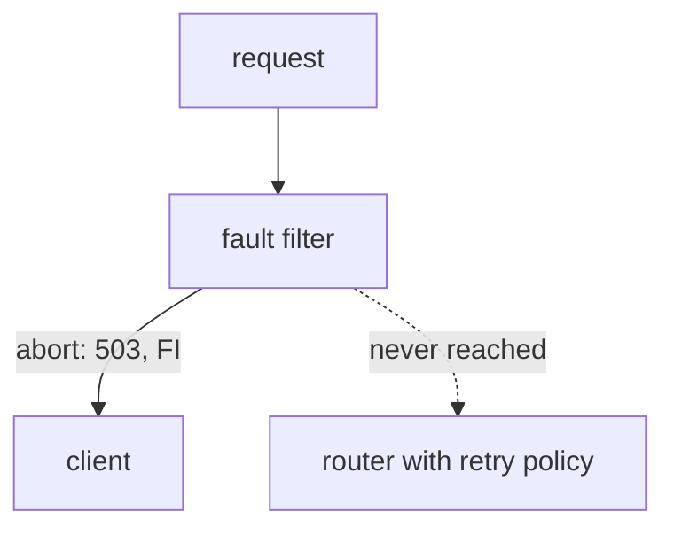

# Solution Walkthrough

The task needs one `VirtualService` with three rules for `notification-service`, a second `VirtualService` with a timeout for `booking-service`, and two fault tests that run independently. A `VirtualService` is the Istio object that sets how requests to a host are routed. A fault is a setting that makes the sidecar proxy return an error or add a delay. The result of the first test is the lesson of the lab: a retry policy that you configure and that never runs. Items 1 to 9 build the first object rule by rule. Item 10 builds the second object. Items 11 to 14 run the tests.

---

## Start: Measure The Baseline

The task describes a call chain `tester → booking-service → notification-service`, used by other teams, and no `VirtualService`. Check that this is true, and send one request from `tester`. Print the status code and the time:

```sh
kubectl -n orders get virtualservice
kubectl -n orders get pods | awk '{print $1,$2,$3}'
kubectl -n orders exec deploy/tester -- \
  curl -s -o /dev/null -w '%{http_code} %{time_total}s\n' -X POST http://booking-service/book
kubectl -n orders get deploy -o custom-columns=NAME:.metadata.name,REPLICAS:.spec.replicas,UID:.metadata.uid
```

```text
No resources found in orders namespace.
NAME READY STATUS
booking-service-v1-69fb4b998f-8pkdf 2/2 Running
notification-service-v1-54dd46d4b6-kns9r 2/2 Running
tester-69699fd775-gzw5t 2/2 Running
200 0.012076s
NAME                      REPLICAS   UID
booking-service-v1        1          930d1763-dcc6-4620-b92e-5d975de3863a
notification-service-v1   1          fb3d72d9-f32a-48c3-b97d-24b0ca64dbb7
tester                    1          bee9d8d5-353a-4362-a60c-ef24ee96ca2d
```

Other teams use this namespace. Every rule that you add without a `match` changes their requests too. That is why each test gets its own header value, and a clean plain rule goes last.

---

## Items 1 To 5: Rule 1, The Abort With A Retry Policy

> **Task item 1:** Matches the header **`x-chaos: abort`**.
>
> **Task item 2:** Injects an `abort` with `httpStatus` **`503`** at **100%**.
>
> **Task item 3:** Has a retry policy on the **same rule**: `attempts` **2**, `perTryTimeout` **`1s`**, `retryOn` **`gateway-error`**. The configuration is valid, and you will see it do nothing.
>
> **Task item 4:** Sets `timeout` to **`5s`**, well above the time the retries need, so the timeout does not cut the retries short.
>
> **Task item 5:** Routes to `notification-service`.

The five items describe the first rule. Check the time budget of item 4: two retries plus the first try are 3 tries, and 3 tries × `perTryTimeout` `1s` are 3 seconds. A `timeout` of `5s` leaves room. The sidecar proxy is the Envoy container that Istio adds to each pod. It reads the rules from top to bottom and uses the first one that matches. Save this as `virtualservice-notification.yaml`. It holds only the first rule for now:

```yaml
apiVersion: networking.istio.io/v1
kind: VirtualService
metadata:
  name: notification
  namespace: orders
spec:
  hosts:
    - notification-service
  http:
    - match:
        - headers:
            x-chaos:
              exact: abort
      fault:
        abort:
          httpStatus: 503
          percentage:
            value: 100
      retries:
        attempts: 2
        perTryTimeout: 1s
        retryOn: gateway-error
      timeout: 5s
      route:
        - destination:
            host: notification-service
```

Apply it:

```sh
kubectl apply -f virtualservice-notification.yaml
```

```text
virtualservice.networking.istio.io/notification created
```

Check items 1 to 5. Print the first rule:

```sh
kubectl -n orders get virtualservice notification -o jsonpath='{.spec.http[0]}{"\n"}'
```

```text
{"fault":{"abort":{"httpStatus":503,"percentage":{"value":100}}},"match":[{"headers":{"x-chaos":{"exact":"abort"}}}],"retries":{"attempts":2,"perTryTimeout":"1s","retryOn":"gateway-error"},"route":[{"destination":{"host":"notification-service"}}],"timeout":"5s"}
```

The rule matches `x-chaos: abort`, aborts with `503` at 100%, has the retry policy, has `timeout` `5s`, and routes to `notification-service`.

---

## Items 6 To 8: Rule 2, The Delay

> **Task item 6:** Matches the header **`x-chaos: delay`**.
>
> **Task item 7:** Injects a `delay` with `fixedDelay` **`7s`** at **100%**.
>
> **Task item 8:** Routes to `notification-service`, with **no** timeout and **no** retries on this rule.

Each test uses its own header value, because the first matching rule wins. Add the second rule to `virtualservice-notification.yaml`, below the first one:

```yaml
    - match:
        - headers:
            x-chaos:
              exact: delay
      fault:
        delay:
          fixedDelay: 7s
          percentage:
            value: 100
      route:
        - destination:
            host: notification-service
```

Apply the file again:

```sh
kubectl apply -f virtualservice-notification.yaml
```

```text
virtualservice.networking.istio.io/notification configured
```

Check items 6 to 8. Print the second rule:

```sh
kubectl -n orders get virtualservice notification -o jsonpath='{.spec.http[1]}{"\n"}'
```

```text
{"fault":{"delay":{"fixedDelay":"7s","percentage":{"value":100}}},"match":[{"headers":{"x-chaos":{"exact":"delay"}}}],"route":[{"destination":{"host":"notification-service"}}]}
```

The rule matches `x-chaos: delay`, delays by `7s` at 100%, and routes to `notification-service`. It has no `timeout` and no `retries`.

---

## Item 9: Rule 3, Every Other Request

> **Task item 9:** No `match` block, no fault, no timeout, no retries. Routes to `notification-service`.

A rule without `match` matches every request, so it must be last. Add it to the end of `virtualservice-notification.yaml`:

```yaml
    - route:
        - destination:
            host: notification-service
```

Apply the file again:

```sh
kubectl apply -f virtualservice-notification.yaml
```

```text
virtualservice.networking.istio.io/notification configured
```

Check item 9. Print the match, the fault, the retries and the timeout of every rule:

```sh
kubectl -n orders get virtualservice notification \
  -o jsonpath='{range .spec.http[*]}{.match}{" fault=["}{.fault}{"] retries=["}{.retries}{"] timeout=["}{.timeout}{"]\n"}{end}'
```

```text
[{"headers":{"x-chaos":{"exact":"abort"}}}] fault=[{"abort":{"httpStatus":503,"percentage":{"value":100}}}] retries=[{"attempts":2,"perTryTimeout":"1s","retryOn":"gateway-error"}] timeout=[5s]
[{"headers":{"x-chaos":{"exact":"delay"}}}] fault=[{"delay":{"fixedDelay":"7s","percentage":{"value":100}}}] retries=[] timeout=[]
 fault=[] retries=[] timeout=[]
```

There are exactly three rules, in the right order. The third rule has no match, no fault, no retries and no timeout.

---

## Item 10: The Timeout On `booking-service`

> **Task item 10:** The timeout for the delay test goes **there**, one hop before the fault, and not next to it. In the sidecar proxy, the fault filter holds the request before the router starts the request to the destination. A `timeout` on the same rule belongs to the router, so it never sees the delay, and the request waits all seven seconds. Only a timeout that a different proxy enforces (the proxy of `tester`, on its call to `booking-service`) can stop an injected delay early.

Create a second `VirtualService` named `booking` for the host `booking-service`, with one rule without a `match`, a `timeout` of `2s`, and the destination `booking-service`. Save this as `virtualservice-booking.yaml`:

```yaml
apiVersion: networking.istio.io/v1
kind: VirtualService
metadata:
  name: booking
  namespace: orders
spec:
  hosts:
    - booking-service
  http:
    - timeout: 2s
      route:
        - destination:
            host: booking-service
```

Apply it:

```sh
kubectl apply -f virtualservice-booking.yaml
```

```text
virtualservice.networking.istio.io/booking created
```

Check item 10. Print the host and the rule, and let Istio check the objects:

```sh
kubectl -n orders get virtualservice booking -o jsonpath='{.spec.hosts} {.spec.http}{"\n"}'
istioctl analyze -n orders
```

```text
["booking-service"] [{"route":[{"destination":{"host":"booking-service"}}],"timeout":"2s"}]

✔ No validation issues found when analyzing namespace: orders.
```

---

## Item 13: Other Requests Are Untouched

> **Task item 13:** Five requests with **no** `x-chaos` header return **200**, fast.

Always check this first, before you cause failures. If the scoping were wrong, you would see it here. `istiod`, the Istio control plane, sends the rules to the proxies, so wait a few seconds after the last apply:

```sh
for i in 1 2 3 4 5; do
  kubectl -n orders exec deploy/tester -- \
    curl -s -o /dev/null -w '%{http_code} %{time_total}s\n' -X POST http://booking-service/book
done
```

```text
200 0.013067s
200 0.003050s
200 0.003290s
200 0.002283s
200 0.002259s
```

All five requests return `200` in a few milliseconds.

---

## Item 11: The Abort Test, One Attempt

> **Task item 11:** A request with `x-chaos: abort` fails, and the access log of the `booking-service` proxy shows exactly **1** attempt to `notification-service`, with the response flag **`FI`** (fault injected), not three. The retry policy is configured and still never runs. An injected abort is a response that the fault filter makes itself, and the fault filter sits before the router. So the router never sees a failed attempt to retry. Retries recover from short failures of the destination; an injected abort never reaches the destination.

Predict the result first. Most people expect three attempts: the first one plus two retries. The real answer is one. The fault filter answers the request with `503` itself, so the request never reaches the router, where the retry policy lives:



The diagram shows that the retry policy is valid, but the router never gets a failed attempt to retry. Count the `FI` lines in the access log of the `booking-service` proxy before and after one request. The access log has one line per request, and the proxy writes it a moment after the request:

```sh
BEFORE=$(kubectl -n orders logs -l app=booking-service -c istio-proxy --tail=-1 | grep -c ' FI ')
kubectl -n orders exec deploy/tester -- \
  curl -s -o /dev/null -w '%{http_code} %{time_total}s\n' -H "x-chaos: abort" -X POST http://booking-service/book
sleep 4
AFTER=$(kubectl -n orders logs -l app=booking-service -c istio-proxy --tail=-1 | grep -c ' FI ')
echo "FI-flagged attempts: $((AFTER - BEFORE))"
kubectl -n orders logs -l app=booking-service -c istio-proxy --tail=6 | grep ' FI ' | tail -1
echo "503 lines at notification-service: $(kubectl -n orders logs -l app=notification-service -c istio-proxy --tail=-1 | grep -c ' 503 ')"
```

```text
503 0.006596s
FI-flagged attempts: 1
[2026-10-20T21:35:17.791Z] "POST /notify HTTP/1.1" 503 FI fault_filter_abort - "-" 0 18 0 - "-" "curl/8.23.0" "1b9a21c0-58cd-9ee9-b6cd-552142aab89a" "notification-service" "-" outbound|80||notification-service.orders.svc.cluster.local - 10.96.180.98:80 10.244.0.8:45836 - -
503 lines at notification-service: 0
```

One client request produced one attempt with the flag `FI`, in about 7 milliseconds. The upstream host in the line is `"-"`: the proxy of `booking-service` answered the request itself and never opened a connection to `notification-service`. The access log of `notification-service` has no `503` line at all.

---

## Item 12: The Delay Test, A Timeout After Two Seconds

> **Task item 12:** A request with `x-chaos: delay` fails after about **2 seconds**, and the access log of the **`tester`** proxy shows the response flag **`UT`** (upstream request timeout) for `booking-service`.

```sh
kubectl -n orders exec deploy/tester -- \
  curl -s -o /dev/null -w '%{http_code} %{time_total}s\n' -H "x-chaos: delay" -X POST http://booking-service/book
sleep 3
kubectl -n orders logs deploy/tester -c istio-proxy --tail=-1 | grep ' 504 UT ' | tail -1
```

```text
504 2.004103s
[2026-10-20T21:35:22.041Z] "POST /book HTTP/1.1" 504 UT response_timeout - "-" 0 24 2000 - "-" "curl/8.23.0" "514cd5c6-997e-929a-a50c-5a922115014c" "booking-service" "10.244.0.8:8083" outbound|80||booking-service.orders.svc.cluster.local 10.244.0.10:55108 10.96.127.247:80 10.244.0.10:52634 - -
```

The request ended after two seconds, not seven. The timeout stopped the delay. Note which proxy logged it. `UT` is in the log of the client, `tester`, on its request to `booking-service`, because that proxy enforces the 2-second timeout. The delay itself is applied one hop further, in the proxy of `booking-service`.

The two flags of this lab help you read failures. `FI` means "the proxy made this response itself", and `UT` means "the timeout of the proxy expired". In this lab they appear one hop apart, and that is why the timeout had to go on the other `VirtualService`.

---

## Item 14: The Right Host, And The Faults In The Client Proxy

> **Task item 14:** The `VirtualService` is for host `notification-service`, and the faults appear in the route configuration of the `booking-service` proxy.

```sh
kubectl -n orders get virtualservice -o custom-columns=NAME:.metadata.name,HOSTS:.spec.hosts
istioctl proxy-config routes deploy/booking-service-v1 -n orders -o json | grep -c 'envoy.filters.http.fault'
istioctl proxy-config routes deploy/booking-service-v1 -n orders -o json | grep -E '"fixedDelay"|"httpStatus"'
```

```text
NAME           HOSTS
booking        [booking-service]
notification   [notification-service]
2
                                    "httpStatus": 503,
                                    "fixedDelay": "7s",
```

The `notification` object is for `notification-service`. The route table of the `booking-service` proxy holds two fault filters, one with `httpStatus` `503` and one with `fixedDelay` `7s`. The `VirtualService` names the destination host, but the proxy of the calling workload applies the fault.

---

## Clean Up

A fault is configuration. The `x-chaos` rules do no harm if you leave them, because nobody else sends that header, but deleting faults is the habit that keeps an unscoped fault from becoming an outage:

```sh
kubectl -n orders delete virtualservice notification
```

The grader needs the objects, so apply `virtualservice-notification.yaml` again before you submit.

---

## Submit

Send the lab for grading:

```sh
astrona submit -c sections/section-050/capstone/labs/lab-01
```

The grader sends marked and unmarked requests, reads the access logs, and checks both `VirtualService` objects.

---

## Mistakes That Fail The Grader

- **Expecting the retry policy to produce three attempts (items 3 and 11).** It produces one. The fault filter answers before the router, so the retries never run.
- **Putting the 2s timeout next to the delay on rule 2 (items 8 and 10).** It does nothing there. The fault filter holds the request before the router starts to time it, so the call takes the full seven seconds, and the proxy never logs `UT`.
- **Adding retries to rule 2 (item 8).** The task asks for none.
- **Anything on the plain rule (item 9).** No fault, no timeout and no retries: requests without the header must not change.
- **Both fault rules matching the same header value (items 1 and 6).** They need different values, because the first matching rule wins.
- **The plain rule placed first (items 9 and 13).** It matches every request, so neither test ever runs.
- **Putting the faults on `booking-service` (item 14).** That delays the request from `tester` and tests the wrong hop.
- **Reading only the final status (items 11 and 12).** The `FI` evidence is in the proxy log of the middle service, and the `UT` evidence is in the log of the client.
