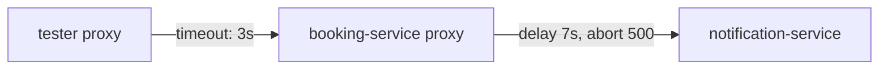

# Solution Walkthrough

The task needs two `VirtualService` objects. A `VirtualService` is the Istio object that sets how requests to a host are routed, including faults and timeouts. One object is for `notification-service`, with a fault rule that only some requests match, and a plain rule for all other requests. The other object is for `booking-service`, and it holds the timeout. Items 1 to 4 build the first object. Item 5 builds the second. Items 6 to 10 prove the result, and the order of the checks matters: the walkthrough first checks that other requests are untouched, because the grader fails the lab if any of them is affected.

---

## Start: Measure The Baseline

The task describes a call chain `tester → booking-service → notification-service` and says that no `VirtualService` exists. Check that this is true, and send one request from the `tester` pod. Print the status code and the time:

```sh
kubectl -n fault-demo get virtualservice
kubectl -n fault-demo get pods | awk '{print $1,$2,$3}'
kubectl -n fault-demo exec deploy/tester -- \
  curl -s -o /dev/null -w '%{http_code} %{time_total}s\n' -X POST http://booking-service/book
kubectl -n fault-demo get deploy -o custom-columns=NAME:.metadata.name,REPLICAS:.spec.replicas,UID:.metadata.uid
```

```text
No resources found in fault-demo namespace.
NAME READY STATUS
booking-service-v1-69fb4b998f-42lhl 2/2 Running
notification-service-v1-54dd46d4b6-zvpbg 2/2 Running
tester-69699fd775-pf9dc 2/2 Running
200 0.011112s
NAME                      REPLICAS   UID
booking-service-v1        1          2be851e3-9f11-4f2c-a55e-8871fa9216ae
notification-service-v1   1          29ef80d3-03ea-46e4-8d84-80f62e4394f9
tester                    1          c02ac9ac-7715-4fe4-953e-7e1440b6311b
```

The request takes about 11 milliseconds across two hops. Both numbers matter later: an abort changes the status, and a delay changes the time.

---

## Items 1 To 3: The Scoped Fault

> **Task item 1:** Matches the header **`end-user: tester`**.
>
> **Task item 2:** Injects **both**:
>
> * a `delay` with `fixedDelay` **`7s`** at **100%**
> * an `abort` with `httpStatus` **`500`** at **100%**
>
> **Task item 3:** Routes to `notification-service`.

The three items describe the first rule of the `notification` object. A fault is a setting that makes the sidecar proxy add a delay or return an error, to test how callers react. The sidecar proxy is the Envoy container that Istio adds to each pod. The `match` on the header limits the fault to requests that carry `end-user: tester`, so other teams that use the namespace are not affected. The fault belongs on the host that should look broken, which is `notification-service`.

Save this as `virtualservice-notification.yaml`. It holds only the first rule for now:

```yaml
apiVersion: networking.istio.io/v1
kind: VirtualService
metadata:
  name: notification
  namespace: fault-demo
spec:
  hosts:
    - notification-service
  http:
    - match:
        - headers:
            end-user:
              exact: tester
      fault:
        delay:
          fixedDelay: 7s
          percentage:
            value: 100
        abort:
          httpStatus: 500
          percentage:
            value: 100
      route:
        - destination:
            host: notification-service
```

Apply it:

```sh
kubectl apply -f virtualservice-notification.yaml
```

```text
virtualservice.networking.istio.io/notification created
```

Check items 1 to 3. Print the first rule:

```sh
kubectl -n fault-demo get virtualservice notification -o jsonpath='{.spec.http[0]}{"\n"}'
```

```text
{"fault":{"abort":{"httpStatus":500,"percentage":{"value":100}},"delay":{"fixedDelay":"7s","percentage":{"value":100}}},"match":[{"headers":{"end-user":{"exact":"tester"}}}],"route":[{"destination":{"host":"notification-service"}}]}
```

The rule matches the header `end-user: tester`. It has a delay of `7s` and an abort with status `500`, both at 100%, and it routes to `notification-service`.

---

## Item 4: The Plain Rule For Every Other Request

> **Task item 4:** No `match` block. Routes to `notification-service` with no fault and no timeout.

A rule without `match` matches every request, so it must be second. If it came first, the fault rule would never run. Add the rule to `virtualservice-notification.yaml`, below the first one:

```yaml
    - route:
        - destination:
            host: notification-service
```

Apply the file again:

```sh
kubectl apply -f virtualservice-notification.yaml
```

```text
virtualservice.networking.istio.io/notification configured
```

Check item 4. Print the match, the fault and the timeout of each rule:

```sh
kubectl -n fault-demo get virtualservice notification \
  -o jsonpath='{range .spec.http[*]}{.match}{" fault="}{.fault}{" timeout=["}{.timeout}{"]\n"}{end}'
```

```text
[{"headers":{"end-user":{"exact":"tester"}}}] fault={"abort":{"httpStatus":500,"percentage":{"value":100}},"delay":{"fixedDelay":"7s","percentage":{"value":100}}} timeout=[]
 fault= timeout=[]
```

There are exactly two rules. The second has no match, no fault and no timeout.

Before you add the timeout, see what the fault does alone. Send a request with the header:

```sh
kubectl -n fault-demo exec deploy/tester -- \
  curl -s -o /dev/null -w '%{http_code} %{time_total}s\n' -H "end-user: tester" -X POST http://booking-service/book
```

```text
500 7.022392s
```

The request waits the full 7 seconds, and then it gets the `500` of the abort. The service `booking-service` copies the request headers onto its own call to `notification-service`. That is why the header match works on the second hop. An application that does not copy headers cannot be tested this way.

---

## Item 5: The Timeout On `booking-service`

> **Task item 5:** One rule, no `match`, `timeout` **`3s`**, routing to `booking-service`.

The timeout goes on a different `VirtualService`, for this reason. Inside a sidecar proxy, a request passes a chain of filters. The fault filter applies the delay and the abort. The router comes after it. It sends the request to the destination, and it enforces the `timeout` of the route. While the fault filter holds the request, the router has not started yet, so a `timeout` on the same rule never sees the delay. A timeout can cut an injected delay short only when a different proxy enforces it, one hop earlier.



The diagram shows that the proxy of `tester` enforces the timeout on the first hop, and the proxy of `booking-service` applies the fault on the second hop. The timeout stops the whole request after three seconds, which is before the seven-second delay ends, so the abort never runs. Save this as `virtualservice-booking.yaml`:

```yaml
apiVersion: networking.istio.io/v1
kind: VirtualService
metadata:
  name: booking
  namespace: fault-demo
spec:
  hosts:
    - booking-service
  http:
    - timeout: 3s
      route:
        - destination:
            host: booking-service
```

Apply it:

```sh
kubectl apply -f virtualservice-booking.yaml
```

```text
virtualservice.networking.istio.io/booking created
```

Check item 5. Print the host and the rule, and let Istio check the objects:

```sh
kubectl -n fault-demo get virtualservice booking -o jsonpath='{.spec.hosts} {.spec.http}{"\n"}'
istioctl analyze -n fault-demo
```

```text
["booking-service"] [{"route":[{"destination":{"host":"booking-service"}}],"timeout":"3s"}]

✔ No validation issues found when analyzing namespace: fault-demo.
```

The object has one rule without `match`, a `timeout` of `3s`, and the destination `booking-service`.

---

## Item 7: Other Requests Are Untouched

> **Task item 7:** A `POST /book` with **no** header returns **200** in well under a second, five times in a row. A fault without a `match` fails this check.

This check comes before item 6 on purpose. It tells a test apart from an outage. Send five requests without the header:

```sh
for i in 1 2 3 4 5; do
  kubectl -n fault-demo exec deploy/tester -- \
    curl -s -o /dev/null -w '%{http_code} %{time_total}s\n' -X POST http://booking-service/book
done
```

```text
200 0.006820s
200 0.002057s
200 0.002327s
200 0.002181s
200 0.002663s
```

All five requests return `200` in a few milliseconds. Every other client works as before.

---

## Item 6: The Marked Request Fails After About Three Seconds

> **Task item 6:** A `POST /book` with `end-user: tester` does **not** return `200`, and returns after about **3 seconds**: the 7-second delay runs into the 3-second timeout one hop earlier, so the timeout fires before the abort would.

```sh
kubectl -n fault-demo exec deploy/tester -- \
  curl -s -o /dev/null -w '%{http_code} %{time_total}s\n' -H "end-user: tester" -X POST http://booking-service/book
```

```text
504 3.008769s
```

The request returns after 3 seconds, not 7, and with a `504` and not the `500` that you configured. Without the timeout, the same request gave `500` after 7 seconds. If this returns `200`, the header did not reach the second hop, or `istiod`, the Istio control plane, has not sent the rules to the proxies yet. Wait a few seconds and send it again.

---

## Item 8: The Timeout Fired In The Client Proxy

> **Task item 8:** The access log of the `tester` sidecar proxy has a `504 UT` line (UT: upstream request timeout): the injected delay really made the route timeout fire.

The access log has one line per request. The proxy writes the line a moment after the request ends. Search it for `504 UT`:

```sh
sleep 3
kubectl -n fault-demo logs deploy/tester -c istio-proxy --tail=-1 | grep ' 504 UT ' | tail -1
```

```text
[2026-10-20T21:26:16.642Z] "POST /book HTTP/1.1" 504 UT response_timeout - "-" 0 24 3001 - "-" "curl/8.23.0" "9c83e35b-3f32-9bc6-97db-56206711ac1f" "booking-service" "10.244.0.8:8083" outbound|80||booking-service.fault-demo.svc.cluster.local 10.244.0.10:43642 10.96.216.182:80 10.244.0.10:54042 - -
```

The response flag `UT` stands for "upstream request timeout". It is in the log of the client, `tester`, on its request to `booking-service`, after 3001 milliseconds. That is the 3-second route timeout firing. The fault itself is applied one hop further, in the proxy of `booking-service`, so `UT` does not appear in the log of `booking-service`.

---

## Item 9: The Client's Proxy Holds The Fault

> **Task item 9:** The fault appears in the route configuration of the `booking-service` proxy, which shows that the client's proxy applies it.

`istioctl proxy-config routes` prints the routes that a proxy holds. Read the routes of the `booking-service` proxy, and search for the fault filter:

```sh
istioctl proxy-config routes deploy/booking-service-v1 -n fault-demo -o json \
  | grep -i -A16 'envoy.filters.http.fault' | head -18
```

```text
                            "envoy.filters.http.fault": {
                                "@type": "type.googleapis.com/envoy.extensions.filters.http.fault.v3.HTTPFault",
                                "delay": {
                                    "fixedDelay": "7s",
                                    "percentage": {
                                        "numerator": 1000000,
                                        "denominator": "MILLION"
                                    }
                                },
                                "abort": {
                                    "httpStatus": 500,
                                    "percentage": {
                                        "numerator": 1000000,
                                        "denominator": "MILLION"
                                    }
                                }
                            }
```

The fault filter holds the delay `7s` and the abort `500`. Envoy writes a percentage of 100 as a numerator of one million out of a million. The proxy is the one of `booking-service`, which is the client of `notification-service`. The `VirtualService` names the destination host, but the sidecar proxy of the calling workload applies the fault.

---

## Item 10: The Fault Is On `notification-service`, The Timeout On `booking-service`

> **Task item 10:** The fault is on the `VirtualService` for **`notification-service`**, not for `booking-service`. The `booking` `VirtualService` has the timeout and no fault.

```sh
kubectl -n fault-demo get virtualservice -o custom-columns=NAME:.metadata.name,HOSTS:.spec.hosts
kubectl -n fault-demo get virtualservice booking -o jsonpath='fault=[{.spec.http[0].fault}] timeout={.spec.http[0].timeout}{"\n"}'
```

```text
NAME           HOSTS
booking        [booking-service]
notification   [notification-service]
fault=[] timeout=3s
```

The `notification` object is for `notification-service`, and it holds the fault. The `booking` object is for `booking-service`, and it has the timeout `3s` and no fault.

---

## Clean Up

A fault is configuration, and it stays in the cluster after you close your terminal. Delete it when you are done testing:

```sh
kubectl -n fault-demo delete virtualservice notification
```

```text
virtualservice.networking.istio.io "notification" deleted from fault-demo namespace
```

The grader needs the objects, so apply `virtualservice-notification.yaml` again before you submit.

---

## Submit

Send the lab for grading:

```sh
astrona submit -c sections/section-050/module-01/labs/lab-01
```

The grader sends marked and unmarked requests from `tester`, and reads the log and the routes.

---

## Mistakes That Fail The Grader

- **The fault on `booking-service` instead of `notification-service` (items 3 and 10).** It delays the request of `tester` and tests the wrong hop.
- **No header match, or the plain rule first (items 1, 4 and 7).** Every client gets the fault. That is an outage that you caused.
- **A fault or a timeout on the second rule (item 4).** Requests without the header are affected.
- **Expecting a `500` after 7 seconds (item 6).** The timeout of 3 seconds stops the 7-second delay first, so you get a `504` after 3 seconds.
- **Leaving out `percentage` and expecting no fault (item 2).** The default is 100%.
- **Scoping on a header that the middle service does not copy (item 1).** The fault never fires, and nothing tells you why.
- **Reading only the final response code (items 6 and 8).** In a chain with two hops, part of the evidence is in the proxy logs.
