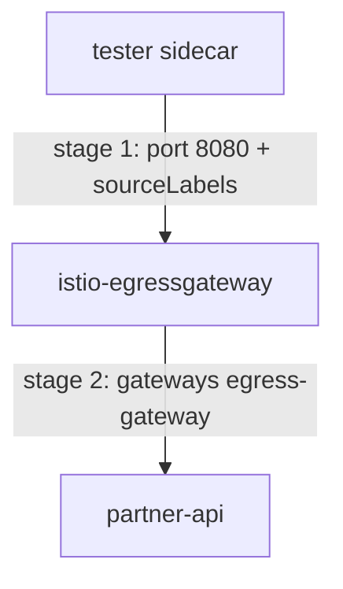

# Solution Walkthrough

The lab needs four objects. Three are simple. The `VirtualService` needs the most care, because one object configures two different proxies: the sidecar proxy of `tester` and the egress gateway. An egress gateway is an Envoy proxy that outbound traffic to outside hosts can be sent through, so the traffic leaves the mesh at one point. Item 1 puts the partner host in the registry. Items 2 and 3 are the `Gateway` and the `DestinationRule`. Item 4 is the two-stage `VirtualService`. Items 5 to 10 prove the result.

---

## Start: Confirm That The Egress Gateway Is Idle

The task says that the egress gateway is running and carries no traffic. Read the partner address, check the gateway pod and the client pods, and list the Istio objects. Then send a direct call from `tester`, and count the lines in the access log of the egress gateway that mention the partner host. The access log has one line for each request that passes through a proxy:

```sh
PARTNER=$(cat /tmp/partner-ip)
echo "partner: $PARTNER"
kubectl -n istio-system get pods -l istio=egressgateway | awk '{print $1,$2,$3}'
kubectl -n egwgw-demo get pods -L egress-allowed | awk '{print $1,$2,$3,$NF}'
kubectl -n egwgw-demo get serviceentry,gateway,destinationrule,virtualservice
kubectl -n egwgw-demo exec deploy/tester -- \
  curl -s -o /dev/null -w 'direct call: %{http_code}\n' --max-time 10 "http://$PARTNER:8080/get"
sleep 4
kubectl -n istio-system logs deploy/istio-egressgateway --tail=-1 | grep -c partner.example.com
kubectl -n egwgw-demo get deploy -o custom-columns=NAME:.metadata.name,UID:.metadata.uid
kubectl -n outside-mesh get pods -o custom-columns=NAME:.metadata.name,UID:.metadata.uid
kubectl -n outside-mesh get svc
```

```text
partner: 10.244.0.10
NAME READY STATUS
istio-egressgateway-cb8fc48c4-wgvrw 1/1 Running
NAME READY STATUS EGRESS-ALLOWED
other-client-6f44676d49-pwklj 2/2 Running 
tester-6967c89699-ppg6g 2/2 Running true
No resources found in egwgw-demo namespace.
direct call: 200
0
NAME           UID
other-client   013c5e39-b2ed-42ee-801e-274469fcb30a
tester         3a8c94f6-de86-47c8-9ec9-244f08d711ca
NAME          UID
partner-api   0ece9353-537a-462f-b0cf-408a2c4dcb9d
No resources found in outside-mesh namespace.
```

The egress gateway runs, and the direct request works. But the access log of the egress gateway recorded nothing: the request went straight out through the own sidecar proxy of `tester`. The sidecar proxy is the Envoy container that Istio adds to a pod. A deployed egress gateway proves nothing by itself. Only the pods of `tester` carry the label `egress-allowed: "true"`, and no Istio object exists yet. The addresses in your run differ. The last two outputs are the state that must stay as it is.

---

## Item 1: Add The Partner Host With A `ServiceEntry`

> **Task item 1:** A `ServiceEntry` named **`partner`** in `egwgw-demo` for host **`partner.example.com`**, with the partner address in `spec.addresses`, port **8080** name `http` protocol **`HTTP`**, `location` **`MESH_EXTERNAL`**, `resolution` **`STATIC`**, and an `endpoints` entry for that address.

A `ServiceEntry` adds a host outside the mesh to the service registry, which is the list of hosts that `istiod`, the Istio control plane, knows about. Without it, neither stage of the route has a host to route. Replace `<PARTNER>` in the YAML with the address that `echo $PARTNER` prints. Save this as `serviceentry-partner.yaml`:

```yaml
apiVersion: networking.istio.io/v1
kind: ServiceEntry
metadata:
  name: partner
  namespace: egwgw-demo
spec:
  hosts:
    - partner.example.com
  addresses:
    - <PARTNER>
  ports:
    - number: 8080
      name: http
      protocol: HTTP
  location: MESH_EXTERNAL
  resolution: STATIC
  endpoints:
    - address: <PARTNER>
```

Apply it:

```sh
kubectl apply -f serviceentry-partner.yaml
```

```text
serviceentry.networking.istio.io/partner created
```

Check item 1:

```sh
kubectl -n egwgw-demo get serviceentry partner -o jsonpath='{.spec}{"\n"}'
```

```text
{"addresses":["10.244.0.10"],"endpoints":[{"address":"10.244.0.10"}],"hosts":["partner.example.com"],"location":"MESH_EXTERNAL","ports":[{"name":"http","number":8080,"protocol":"HTTP"}],"resolution":"STATIC"}
```

---

## Item 2: The `Gateway` For The Egress Gateway

> **Task item 2:** A `Gateway` named **`egress-gateway`** in `egwgw-demo`, selecting **`istio: egressgateway`**, opening port **8080**, protocol **`HTTP`**, for host **`partner.example.com`**. This is the **outside** host name, not an internal one.

The `Gateway` makes the pods of the egress gateway accept requests for the partner host on port `8080`. Read the object from the point of view of the egress gateway. It receives requests whose `Host` header says `partner.example.com`, so that is the host its listener must accept. An internal name here gives you an egress gateway that rejects every request. The selector `istio: egressgateway` selects the egress gateway. With `ingressgateway` you would configure the wrong pod. Save this as `gateway-egress-gateway.yaml`:

```yaml
apiVersion: networking.istio.io/v1
kind: Gateway
metadata:
  name: egress-gateway
  namespace: egwgw-demo
spec:
  selector:
    istio: egressgateway
  servers:
    - port:
        number: 8080
        name: http
        protocol: HTTP
      hosts:
        - partner.example.com
```

Apply it:

```sh
kubectl apply -f gateway-egress-gateway.yaml
```

```text
gateway.networking.istio.io/egress-gateway created
```

Check item 2:

```sh
kubectl -n egwgw-demo get gateway egress-gateway -o jsonpath='{.spec}{"\n"}'
```

```text
{"selector":{"istio":"egressgateway"},"servers":[{"hosts":["partner.example.com"],"port":{"name":"http","number":8080,"protocol":"HTTP"}}]}
```

---

## Item 3: The `DestinationRule` With One Subset

> **Task item 3:** A `DestinationRule` named **`egressgateway-for-partner`** in `egwgw-demo` for host `istio-egressgateway.istio-system.svc.cluster.local`, with a single subset named **`partner`** and no labels.

A subset with no labels narrows nothing. It exists so that stage 1 of the route can name a separate cluster for each outside host. A cluster is a named destination in Envoy. With several hosts through one egress gateway, each host gets its own subset, and the proxy configuration stays readable. Save this as `destinationrule-egressgateway-for-partner.yaml`:

```yaml
apiVersion: networking.istio.io/v1
kind: DestinationRule
metadata:
  name: egressgateway-for-partner
  namespace: egwgw-demo
spec:
  host: istio-egressgateway.istio-system.svc.cluster.local
  subsets:
    - name: partner
```

Apply it:

```sh
kubectl apply -f destinationrule-egressgateway-for-partner.yaml
```

```text
destinationrule.networking.istio.io/egressgateway-for-partner created
```

Check item 3:

```sh
kubectl -n egwgw-demo get destinationrule egressgateway-for-partner -o jsonpath='{.spec}{"\n"}'
```

```text
{"host":"istio-egressgateway.istio-system.svc.cluster.local","subsets":[{"name":"partner"}]}
```

---

## Item 4: The Two-Stage `VirtualService`

> **Task item 4:** A `VirtualService` named **`partner-through-egress`** in `egwgw-demo` for host `partner.example.com`. Its top-level `gateways` lists **both** `mesh` and `egress-gateway`, and it has exactly **two** `http` rules:
>
> * **Stage 1**: `match` on port **8080** **and `sourceLabels: {egress-allowed: "true"}`**. It routes to `istio-egressgateway.istio-system.svc.cluster.local`, subset **`partner`**, port **8080**. Match on the **port and `sourceLabels` only**, and do **not** add `gateways: [mesh]` here. On Istio 1.30.5, combining `gateways: [mesh]` with `sourceLabels` in an `http` rule makes Istio ignore the label, so every sidecar gets the route to the egress gateway. The rule still does not run on the egress gateway, because the egress gateway pod does not carry that label.
> * **Stage 2**: `match` on `gateways: [egress-gateway]` and port **8080**. It routes to `partner.example.com` port **8080**.

A `VirtualService` holds the routing rules for a host. One object holds two rules, and each rule runs in a different proxy:



The diagram shows stage 1 running in the sidecar of `tester` and sending the request to the egress gateway, and stage 2 running in the egress gateway and sending it on to the partner. The top-level `gateways` must list both names. If you leave out `mesh`, `istiod` never gives stage 1 to the sidecars, so no request goes to the egress gateway. If you leave out `egress-gateway`, stage 2 never reaches the egress gateway. Save this as `virtualservice-partner-through-egress.yaml`:

```yaml
apiVersion: networking.istio.io/v1
kind: VirtualService
metadata:
  name: partner-through-egress
  namespace: egwgw-demo
spec:
  hosts:
    - partner.example.com
  gateways:
    - mesh
    - egress-gateway
  http:
    - match:
        - port: 8080
          sourceLabels:
            egress-allowed: "true"
      route:
        - destination:
            host: istio-egressgateway.istio-system.svc.cluster.local
            subset: partner
            port:
              number: 8080
    - match:
        - gateways: [egress-gateway]
          port: 8080
      route:
        - destination:
            host: partner.example.com
            port:
              number: 8080
```

Apply it:

```sh
kubectl apply -f virtualservice-partner-through-egress.yaml
```

```text
virtualservice.networking.istio.io/partner-through-egress created
```

Check item 4. Print the gateways and the rules, and let Istio check the namespace:

```sh
kubectl -n egwgw-demo get virtualservice partner-through-egress \
  -o jsonpath='gateways={.spec.gateways}{"\n"}{range .spec.http[*]}{.match}{" -> "}{.route[0].destination.host}{" "}{.route[0].destination.subset}{":"}{.route[0].destination.port.number}{"\n"}{end}'
istioctl analyze -n egwgw-demo
```

```text
gateways=["mesh","egress-gateway"]
[{"port":8080,"sourceLabels":{"egress-allowed":"true"}}] -> istio-egressgateway.istio-system.svc.cluster.local partner:8080
[{"gateways":["egress-gateway"],"port":8080}] -> partner.example.com :8080

✔ No validation issues found when analyzing namespace: egwgw-demo.
```

There are exactly two rules. Stage 1 matches the port and `sourceLabels` only, and stage 2 matches the gateway and the port.

---

## Items 5 And 6: The Hop Is Real

> **Task item 5:** `GET http://partner.example.com:8080/get` from **`tester`** returns **200**. The mesh resolves that name from the `ServiceEntry`, and the egress gateway's route matches on the host name, so a request to the IP address matches nothing.
>
> **Task item 6:** The **egress gateway's own access log** gains a line for that request, which proves the extra hop happened.

The response looks the same either way, so the proof must come from the access log of the egress gateway. `istiod` sends the objects to the proxies. Wait a few seconds. Count the lines before and after one request from `tester`:

```sh
sleep 4
BEFORE=$(kubectl -n istio-system logs deploy/istio-egressgateway --tail=-1 | grep -c partner.example.com)
kubectl -n egwgw-demo exec deploy/tester -- \
  curl -s -o /dev/null -w 'tester: %{http_code}\n' --max-time 15 "http://partner.example.com:8080/get"
sleep 4
AFTER=$(kubectl -n istio-system logs deploy/istio-egressgateway --tail=-1 | grep -c partner.example.com)
echo "gateway lines: +$((AFTER - BEFORE))"
kubectl -n istio-system logs deploy/istio-egressgateway --tail=5 | grep partner.example.com | tail -1 | cut -c1-230
```

```text
tester: 200
gateway lines: +1
[2026-10-20T22:20:39.065Z] "GET /get HTTP/1.1" 200 - via_upstream - "-" 0 1370 1 0 "10.244.0.8" "curl/8.23.0" "1ad24d1f-22ed-957d-a214-f8089f35ff15" "partner.example.com:8080" "10.244.0.10:8080" outbound|8080||partner.example.com 
```

The request returns `200`, and the egress gateway logged one line, with the address of the calling pod in it. At the start, the same count was `0`. That log is the audit record that the whole setup exists to produce.

---

## Item 7: The Route Of `tester` Points At The Gateway

> **Task item 7:** The `tester` sidecar's route for the outside host points at the **egress gateway Service**, not at the partner address.

Read the routes of the `tester` proxy, and search for the cluster of the egress gateway:

```sh
istioctl proxy-config routes deploy/tester -n egwgw-demo -o json | grep -i '"cluster"' | grep egress | head -1
```

```text
                            "cluster": "outbound|80||istio-egressgateway.istio-system.svc.cluster.local",
```

The destination of `tester` for the outside host is a Service inside the cluster now, the Service of the egress gateway.

---

## Item 8: `sourceLabels` Narrows The Route, Not The Permission

> **Task item 8:** `GET http://partner.example.com:8080/get` from **`other-client`** also returns **200**, and adds **no** new line to the egress gateway's access log. Its pods do not match `sourceLabels`, so its requests go direct. `sourceLabels` limits the route, not the permission.

Repeat the count with a request from `other-client`:

```sh
BEFORE=$(kubectl -n istio-system logs deploy/istio-egressgateway --tail=-1 | grep -c partner.example.com)
kubectl -n egwgw-demo exec deploy/other-client -- \
  curl -s -o /dev/null -w 'other-client: %{http_code}\n' --max-time 15 "http://partner.example.com:8080/get"
sleep 4
AFTER=$(kubectl -n istio-system logs deploy/istio-egressgateway --tail=-1 | grep -c partner.example.com)
echo "gateway lines: +$((AFTER - BEFORE))"
```

```text
other-client: 200
gateway lines: +0
```

The pods of `other-client` do not carry `egress-allowed: "true"`, so stage 1 does not apply to them. They still reach the endpoint, directly, with no line in the access log of the egress gateway. A workload that does not match goes direct, and it is not blocked. To make the egress gateway a real control, you also need the mesh setting `outboundTrafficPolicy: REGISTRY_ONLY`, so that requests to hosts outside the registry are blocked, and an `AuthorizationPolicy` on the egress gateway.

---

## Items 9 And 10: The Host And The Gateways

> **Task item 9:** The `Gateway` object's `servers[].hosts` names `partner.example.com`.
>
> **Task item 10:** The `VirtualService` lists both `mesh` and the egress gateway in its top-level `gateways`.

```sh
kubectl -n egwgw-demo get gateway egress-gateway -o jsonpath='{.spec.servers[*].hosts}{"\n"}'
kubectl -n egwgw-demo get virtualservice partner-through-egress -o jsonpath='{.spec.gateways}{"\n"}'
```

```text
["partner.example.com"]
["mesh","egress-gateway"]
```

---

## Nothing Else Changed

The task did not ask you to change any workload. Run the identity commands from the Start section again:

```sh
kubectl -n egwgw-demo get deploy -o custom-columns=NAME:.metadata.name,UID:.metadata.uid
kubectl -n outside-mesh get pods -o custom-columns=NAME:.metadata.name,UID:.metadata.uid
```

```text
NAME           UID
other-client   013c5e39-b2ed-42ee-801e-274469fcb30a
tester         3a8c94f6-de86-47c8-9ec9-244f08d711ca
NAME          UID
partner-api   0ece9353-537a-462f-b0cf-408a2c4dcb9d
```

The output is the same as before.

---

## Submit

Send the lab for grading:

```sh
astrona submit -c sections/section-080/module-01/labs/lab-01
```

The grader sends requests from both clients and reads the access log of the egress gateway.

---

## Mistakes That Fail The Grader

- **Expecting the egress gateway to catch traffic by itself (Start).** It carries nothing until a route sends traffic to it.
- **An internal host name in `servers[].hosts` of the `Gateway` (items 2 and 9).** It must be the outside host.
- **`selector: istio: ingressgateway` (item 2).** That is the wrong gateway. It serves inbound traffic.
- **Swapping the two `match.gateways` values (item 4).** Requests loop, or never go to the egress gateway.
- **Leaving `mesh` out of the top-level `gateways` (items 4 and 10).** Stage 1 never reaches the sidecars.
- **No `ServiceEntry` (item 1).** Neither stage has a host to route.
- **Counting the lines of the egress gateway without a baseline (items 6 and 8).** The log keeps growing.
- **Reading `sourceLabels` as access control (item 8).** It only filters the route. Workloads that do not match go direct.
